::id [9b8626f7-bb54-46cb-8257-c3a329890c90]

# Mnememnid ::topic [ AtticFactory ]

### What ?

C'est un gestionnaire de note augmenté en .md.
Il permet de s'y retrouver dans nos fichier en pouvant filtrer par motclé, mais aussi par topic, ou tag, et meme par date, ce qui permet d'avouter une dimension temporelle a nos document, et retrouver des états de flows.
Il integre enormement de tool pour permettre de transformer une information le plus facilement possible du texte au schéma/dessein et a l'audio : nous pensons qu'une pensé ne doit pas etre limité a du texte (EXCALIDRAW + MERMAID).
Il permet de transformer une doc en chronologie, juste en ajoutant des balise ::date [  ].
Il permet de transformer certains point de vos doc en taches juste en ajoutant ::task
-> Votre paragraphe devient alors automatiquement un tache, dont sa progresision est calculé en fonction des checkbox [ ] validé a l'intérieur de celle ci.
Un calendar permet de naviguer agréablement dans ces chronologie, en affichant autant les doc que les taches.
Une section TaskMAnager est intégré au calendar, ce qui permet de travailler uniquement avec ses taches sous une vue Timeline/KJanban.

### Why ?
J'ai repris mes etudes aprés trentes ans et je me suis retrouvé perdu dans un flow d'information compliqué a géré.
Je suis naturelement mal organisé, jai donc du mettre au point un tool qui me  permette de créer de la structure a partir de mes notes .
J'ai baucoup d'idées, au point de parfois me souvenir que javais eu une idée mais ne sais plus toutes les lister : jai donc ajouter des selecteur temporel et de topic et link direct entre document pour m'y retrouver

### How ?

-  Mermaid
-  Excalidraw
-  STT --> Note vocale
-  TTS --> Transcript une note vocale ou vidéo importé (marche sur les vidéo Youtube)
-  Voice clonage --> Utilisez votre propre voix pour le TTS
-  images / vidéo
-  Sommaire interactif
-  Calendar
-  Task manager system intégré
-  Explore
-  RagLocal --> Necessite Ollama pour le moment -> Pipeline de rag en interne mais pas l'embeder et le LLM. ( app non dépendante)
-  import automatique de document pdf, ou web etc

  balises prises en compte :
  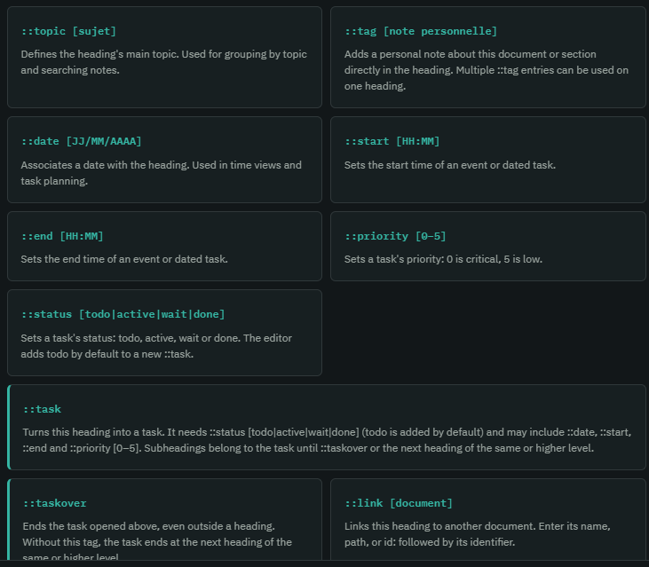

  
### A Venir :

-  MCp : Donnez le controle de vos pensez a votre LLM
-  AppServer : connectez vous directement a GPT pour débloquer le full potentiel de MnemeMind
-  OpenSourceAgentReady : OpenSource, oui , mais qui integre la bonne conf pour que vos agent puisse efficacement ajouter les feature que vous voulez. --> Permet directement depuis l'app de la modifier sans jamais ouvrir le code : design pour les non dev.

## Démo

### Image features
Calendar:
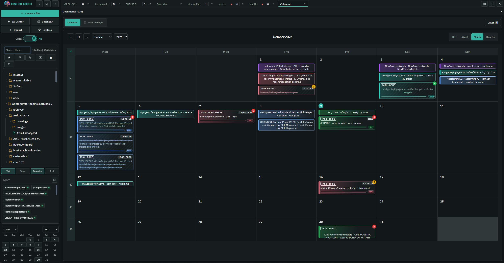

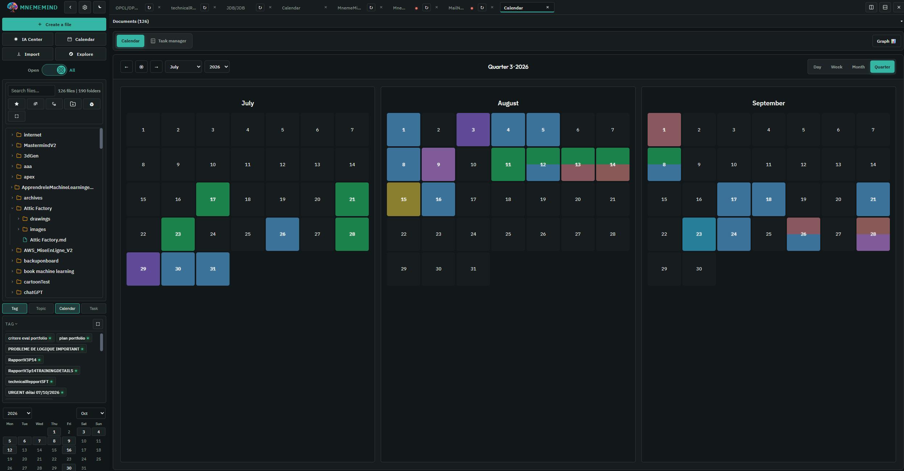
TaskManager
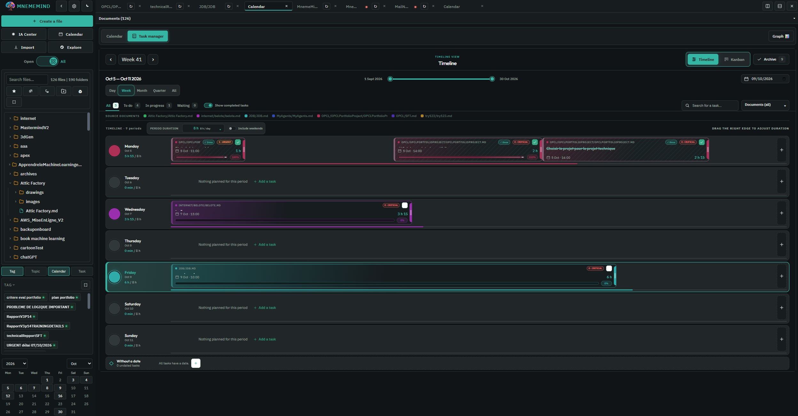

Ia LOcal avec Ollama => Représentation graphique live des embed utilisés par le model
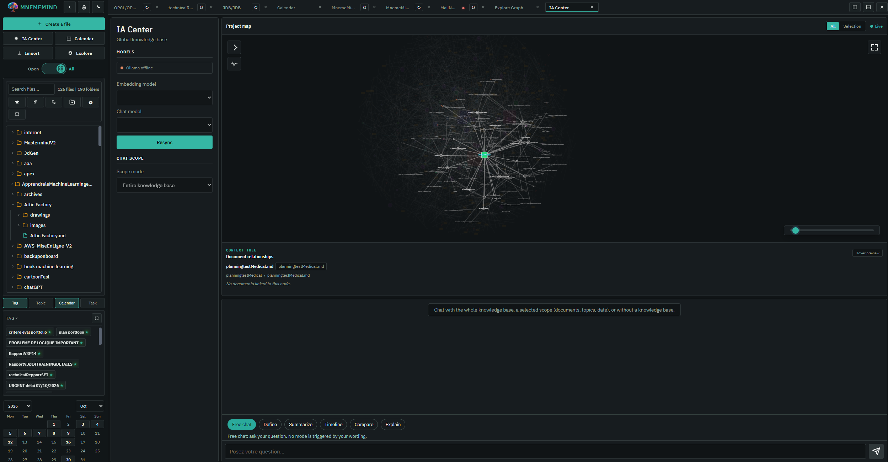
==> Cette partie sera completement modifié lors de l'implemetation de l'app server.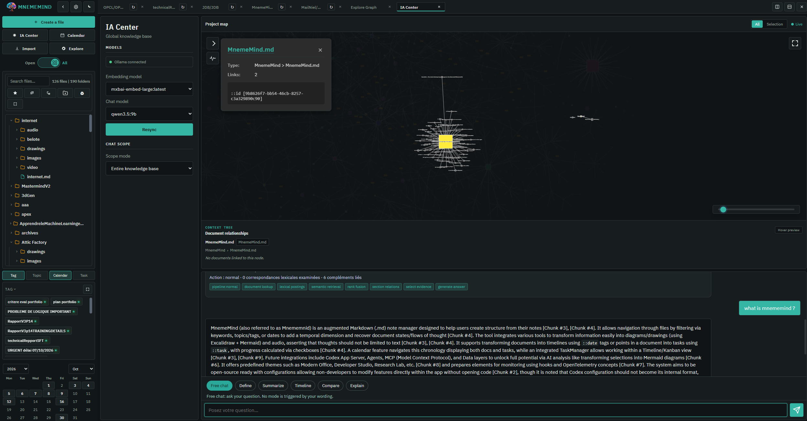
Pouvoir avoir des Excalidraw directement dans son document
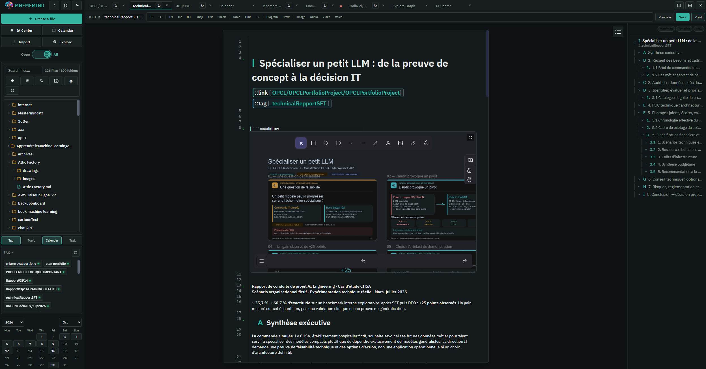

Graph simple Mermaid, prise en charge de l'audio et mode transcript
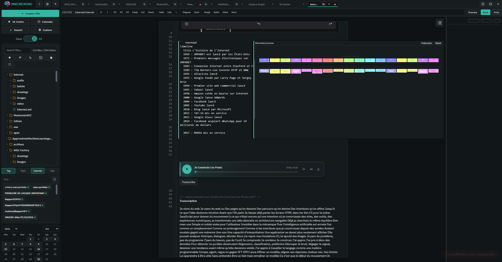

Mode Explore : Recheche des données par Topic, date, mots clé, Tag,
--> Les données sont simulés avec un système de gravité : les element se repulsent entre eux ce qui donne une forme "vivante" de nos données lié a son organisation interne.
La structure meme des cellule finale permettent facilement d'isoler des problemes d'organisation.
L'utilisation des balise temporelle permet de retrouvé des documents et donc fil de pensée de manière chronologique, et permet donc de reconstituer un arbre de raisonement.

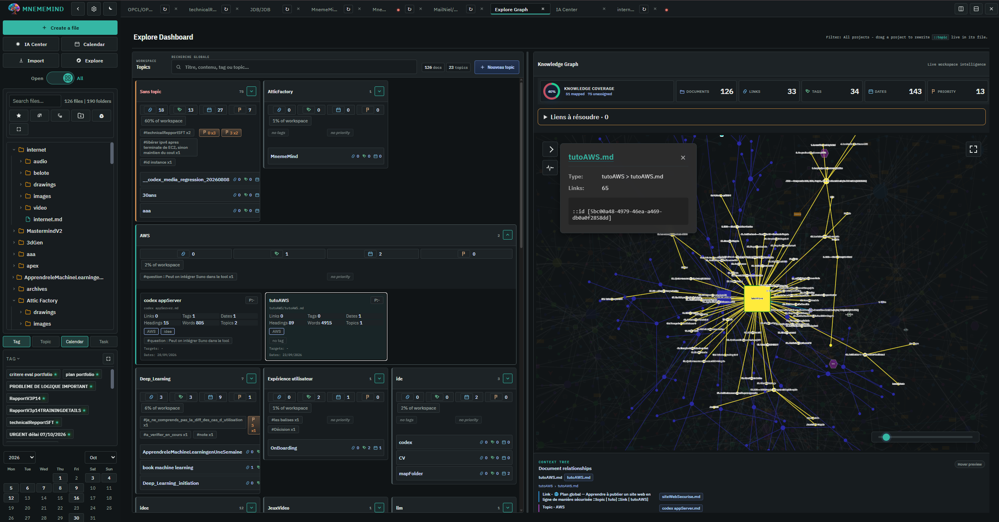

plein ecran:
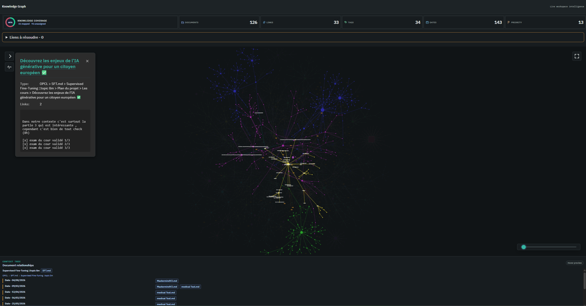

Clonez votre propre voix , pour pouvoir transformer vos note en note audio:
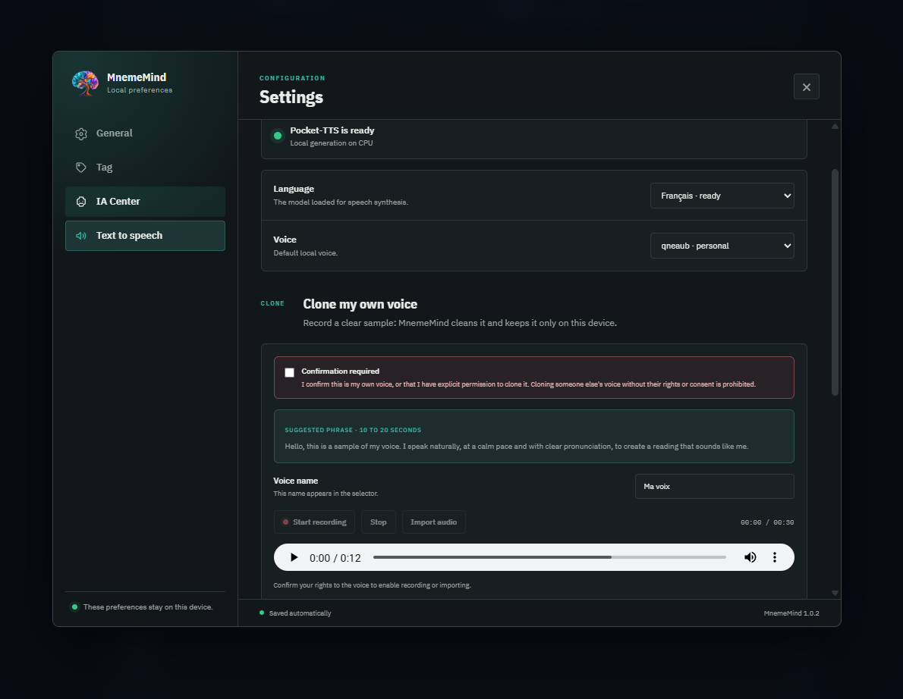

Importez vos pdf, ou site web ou autre doc :
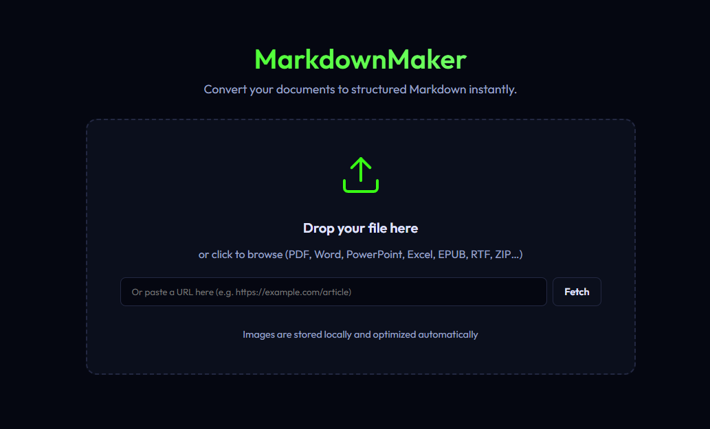
==> Cette feature a subie une petite regression lors d'une migration récente, elle demande a être proprement reconnecté, mais elle fonctionne dans l'idée.

### Vidéo