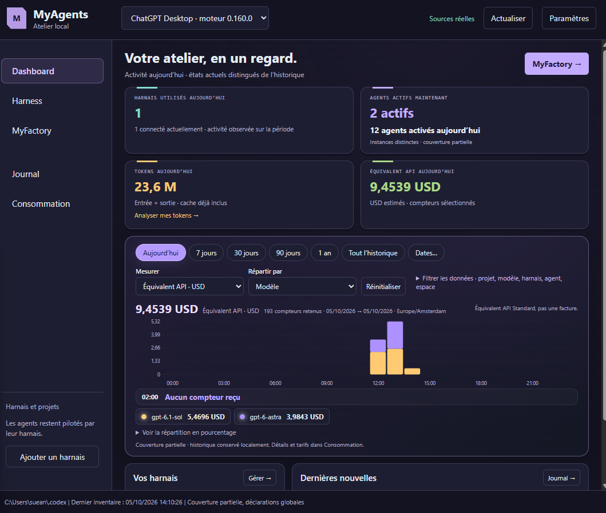
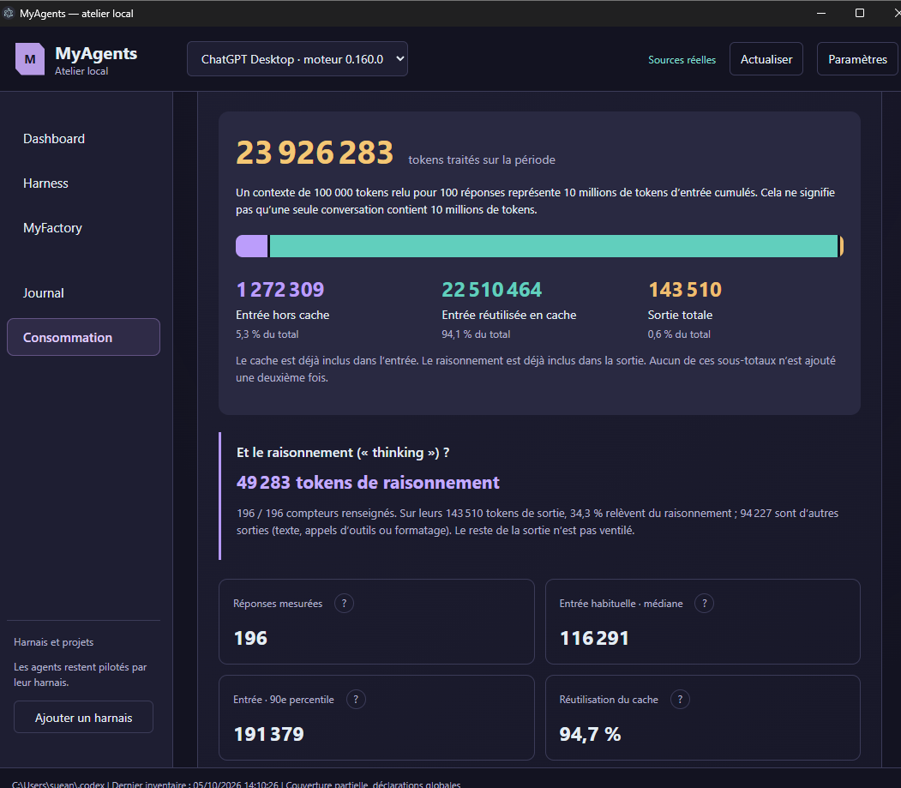
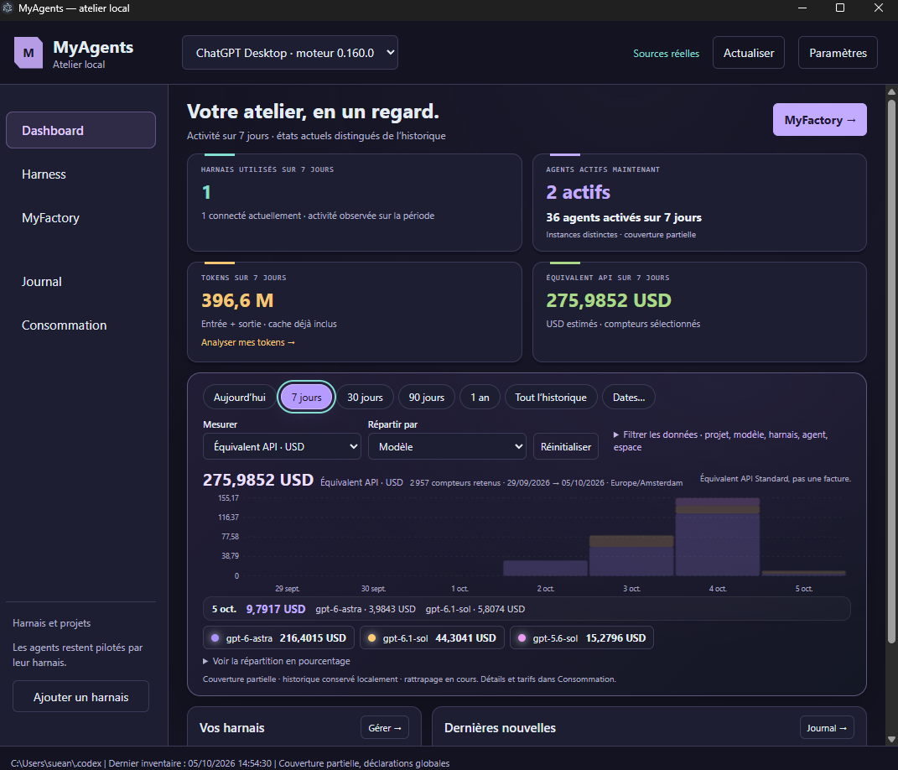
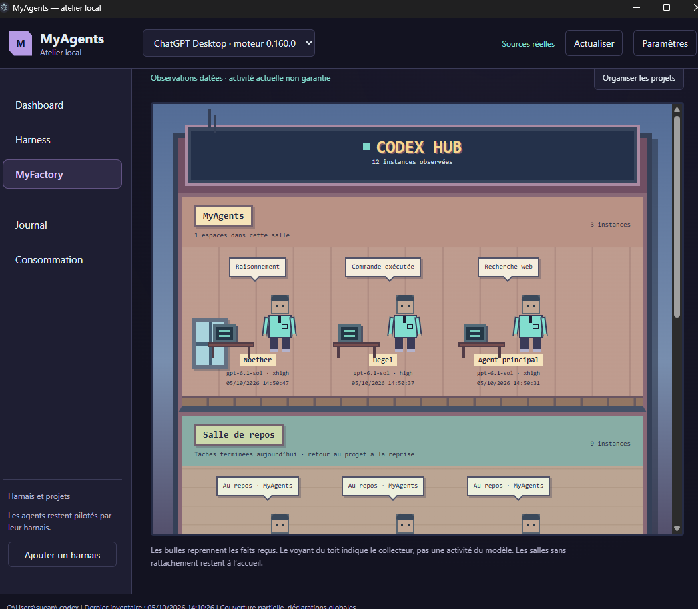
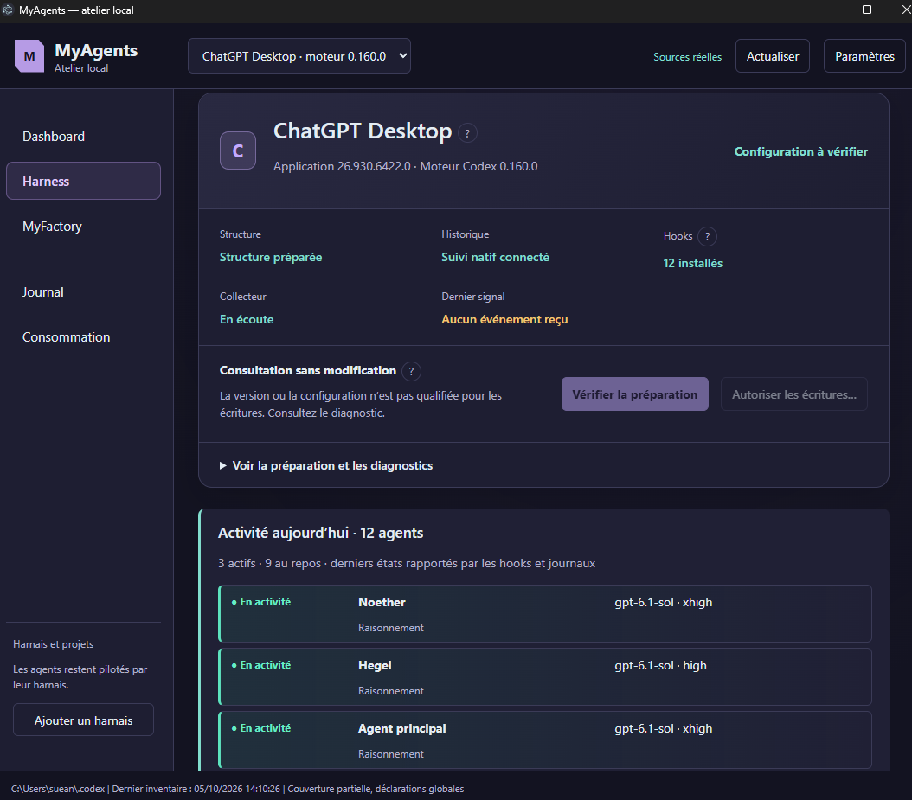

::id [464ec6f6-be11-43a2-853e-b399e553c955]

# MyAgents ::topic [  idee ]
-> Créer un monitoring meta-harness. 
-> PLug ce system dans MnemeMind - ou libre
-> Pouvoir modifier les conf de ses harness facilement, et surveiller ce qu'il se passe de maniere centralisée.

## Feature a ajouter
### Benchmark

=> Pouvoir créer une team avec l'orchestrateur etc, et donner le meme prompt a deux team pour comparer les efficacité .
--> Pas possible lsans le appServeur mais l'idée est tres interessante.

### début du projet : ::date [ 03/10/2026 ]

Mise en place d'un plan d'action et test du model 6.1 : il a des conssignes clair et doit aller jusqu'au point 5 ( mise en place du monde 2d) afin que je puisse verifier, avant de plug d'autre harness -> Actuelement on plug que codex, mais a travers un dico pourt anticiper les connections futures.

test d'un stratégi de dev à developper

### vérifier les gain ::task ::status [done] ::link [ NewProcessAgents] ::date [03/10/2026] ::priority [5]
[x] vérifier que les agent aient bien mis a jour les doc suivi lié au document, et vérifier si la code base a l'air plus structurée que d'habitude.
-> la tech a marché mais pas le resultat

--> Ca a pas marché du tout : jai bien une app tauri mais il a pas utilisé les hook il vien lire les data toutes les 2sec : pas ok : je n'ai meme pas essayer la partie conf je veux pas casser mon codex ahah

::taskover

### pour le design:

Le but est de monitorer, mais aussi de vulgariser : les utilisateur doivent comprendre ce qu'il font meme si ils ne pratiquent pas l'ia.
C'est d'ailleurs le but : ils peuvent se sentir perdu a travers ces harness alors que c'est pas sio compliqué : on leurs donne un espace centralisé ou il peuvent tout controller.

1. dashboard Gamifié :
-  les harnes actif, conso active par harness / comparaison si api token USD via agentAPi - on garde les log et permet d'afficher des courbes de conso par harnais - worktree - agent - tool etc  : un vrai truc detaillé et performant.
-  combien d'agents en cours / actifs aujourd'hui.
-  petite synthèse du nombre de token, taches etc réalisé dans la journée

2. Harness
   -  un onglet par harnais connecté
   -  permet de voir la liste d'agents, de skill, de tool etc du harness , avec la possibilité d'en ajouter -> écris vraiment le skill ou agent etc dans le systeme proprement.
   -  -> chaque builder (agent skill tool) a un module de creation gamifié interactif satisfying
   -  -> le agent builder poura construine des skin de base a donner a son agent, mais on fera le detail de cette partie plus tard.

  3.  MyFactory
  -  un petit monde procédural qui se construit en live en fonction de l'activité de la journée et de l'activité precise des agents actuelemnt.

  -> un harness par immeuble
  -> une salle par projet

#### 04/10/2026 ::date [ 04/10/2026 ]
==> Ok on a une V1, avec les hooks connectés pour codex.
--> Mais c'est immensément plus compliqué que ce que je pensais pour editer la conf correctement, je ne comprends toujuours pas ce qui fait que cest compliqué !
--> Du coup pour le coté Meta-Harness Monitoring je commence a me dire que ça va être tendu de rajouter les rules de dlaude et hermes etc.
----> Mais pas impossible, et cette complexité forme une mini mbarriere a l'entrée actuelement :
conceptuelement deja il faut comprendre le probleme, et techniquement, il n'est finalement pas si simple a résoudre: kje pensais vraiment que ça aurait été l'histoire de 1 ou deux jours max. ( bon tu me direa on a la v1 en 2 jour ahaha)

#### 05/10/2026 ::date [ 05/10/2026 ] ::link [  MastermindV2/MastermindV2] ::tag [ PROBLEME DE LOGIQUE IMPORTANT ]

OMG j'ai fait une terrible erreur : qui aurait du etre evité grace a Mnememind.
--> Jai fais pas mal de recherche dans plein de chat pour absorber le concept de myagent
--> jai du absorber de nombreux concept, mais a un moment T jai réussi a avoir une image globalme d'un bon product
--> je n'ai pas retransmis cette connaissance depuis chatGptWeb dans mon knowledge
--> J'ai finalement conçu moin plan d'action avec une erreur strategique tres important, alors que j'avais anticiper ce probleme en amont, mais ne l'aipas reporté dans mon cahier des charge.
==> GROS PROBLEME DE PROCESS.
==> Il faut que je centralise facilement mais tant que j'ai pas fait un plugin officiel je vois pas comment.

## V2 -> Suppression dict commun + Open telemetry

### POC Valide le Concept

### Besoin de changer de stratégie technique

==> Changement de phylo du tool
Actuelement l'idée était de convertir tout les element des harnais dans une dictionnaire commun pour pouvoir convertir facilement des elements : le probleme était pris a l'envers et ajoute une complexité completement inutile, et surtout un probleme d'utilisation : on ne peux pas configurer efficacement un harnais a travers notre outils, si les configuration qu'on propose ne sont pas propre a l'outil,n on perd de la granularité et c'est nul.
==> C'est plus logique d'importer un harnais tel quel, avec une config plus simple a editer tel quel.
--> Si on veut convertir on ajoutera des adaptateur plus tard ce seras 100 fois plus simple : mais est ce vraiment utile ? 
--> 

==> Ajout de Open Telemetry
ça c'est le moove de trou de balle.
Actuelement on scaln les fichier comme des fou pour trouver des ecart ou autre : ce n'est vraiment pas viable.
-> cest a codex de nous envoyé ce qui change, nous on attends.
--> C'est telement obvious que je comprends pas comment astra est passé a coté : il est vraiment pas fiable pour les tache complexe jai l'impression. ( enfin cest chelou : il réalise tres bien un tache complexe, mais ne choisi pas forcement les routes les plus logique pour parvenir a son objectif : genre il se dit ok comme ça ça va mar'cher alors il fonce, mais il ne prends pas du tout de recul pour savoir si il pourrait faire mieux : on dirait meme qu'il ne connait pas les bonnes pratiques de base : il est ultra technique mais pas de vision globale ? )

CRAZY IDEA
BENCHMARK
=> Pouvoir créer une team avec l'orchestrateur etc, et donner le meme prompt a deux team pour comparer les efficacité .
--> Pas possible lsans le appServeur mais l'idée est tres interessante.   

### La nouvelle Structure ::date [  06/10/2026 ]

Bon l'approche de la nouvelle structure est bonne mais il y a un trou : on a pas de recovery

Donc en gros : 
--> Quand le front est ouvert on le live avec OTEL + Hook
--> Quand le front est fermé, on a service séparer qui continu de prendre OTEL pour remplir SQLlite
=> Quand les deux sont dermé il ne se passe rien : A la réouverture de MyAgents on fait un patch en lisant le JSONL de session codex et en mettant ce qui manque : sur des longue periode d'inactivité on perd du content, mais cets la meilleur approche niveau scale etc.

NORMAL OPERATION
───────────────

Codex
 ├── OTel ────► MyAgents background
 └── Hooks ───►       │
                    SQLite

RECOVERY
────────

MyAgents starts
      │
      ▼
SQLite says:
last covered point = X
      │
      ▼
bounded historical reconciliation
from Codex native session history
      │
      ▼
SQLite
      │
      ▼
live OTel resumes

==> Otel fonctionne avec son service séparé❤️❤️❤️ Par contre il nexporte pas tout les champs dont on a besoin:
Je lance un etude pour voir si on peut réconcilier

=> Bon je vais me prendre un Out Of Token.
--> On a énormément recadrer le produit par rapport au Otel et a la recovery
On a decouvert une spec biszar de suppressiuon des data tous les 0 jours -> je suis en train de la supprimé partout.

#### next time ::date [ 12/10/2026]
Du coup normalement la rodamp expliquera bien tout ça mais il faut 
-  remaper Otel correctement pour correspondre au contrat de data complet
-  Faire le historical recovery, principalement basé sur TokenUsageRecord
-  et puis on est pas loin du front a partiur de la.
Je penses que les prochaines etapes devraient etre beaucoup plus straighjt forward : auj au final jaio passé la journée a anticiper proprement le system et sa mise en place ->  on devrait avoir une roadmap cohérant et whoAmI et Agents : mais on va faire vérifier ça dans le Chat en ligne avant de continuer l'implémentation, jen ai un qui a tout le bon contexwte -> il est pin

==> Bon jai deja vérifier -> ilme restais 2% ahaha, et du coup^je realigne avant de fermer, pour avoir un handoff vraiment propre quand on reprends.
