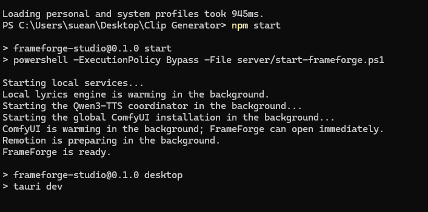
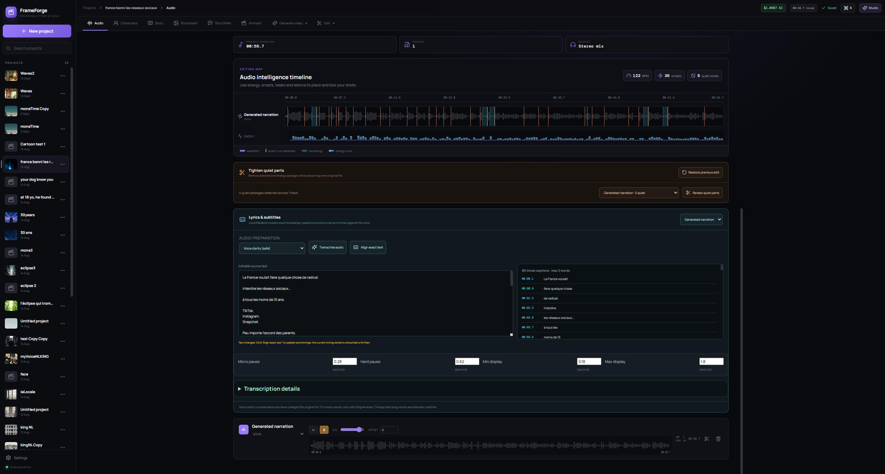
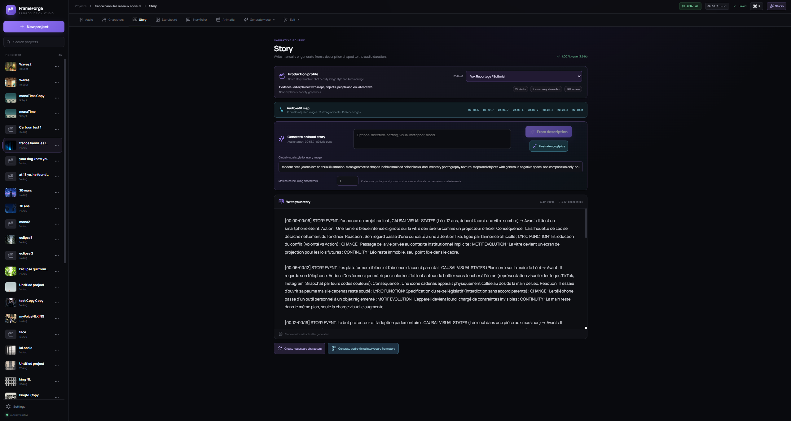
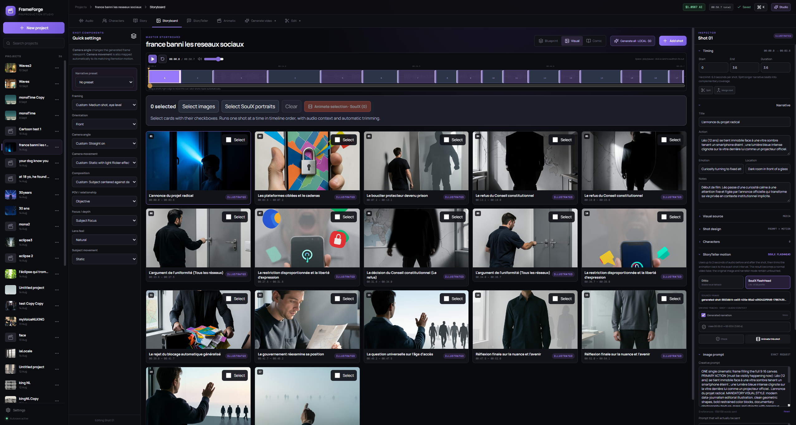
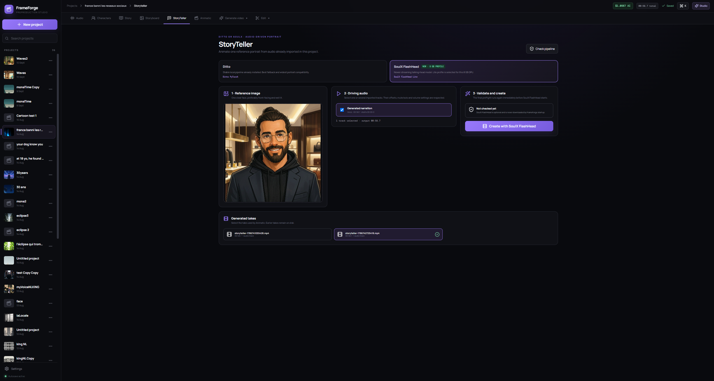
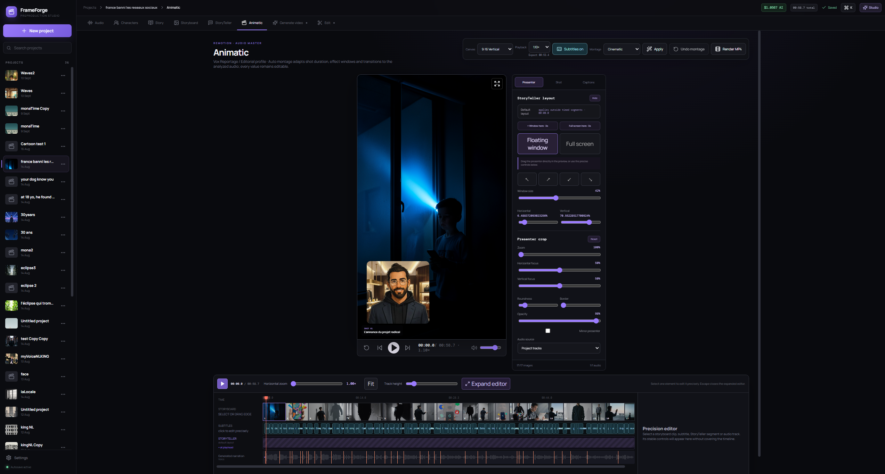

::id [bcff7c5e-18a4-49eb-a035-97d6da1a1bfa]

# Projet Final : PORTFOLIO ::topic [ OPCL ]
## cadrage rapide

 -  Inventorier tous les projets pour faire une map de compétences. 
 -  Déterminer quels projets sont à utiliser comme projets phare du Portfolio.
 -  En choisir Un spécifiquement pour le projet technique
   
   --> Le problème est deep : je ne sais pas ce que je veux montrer.
    --> ça implique un réél positionement sur ce que je veux faire.
    => je recentre de plus en plus sur  des création  App IA, pour des client ou pour Attic Factory directement, et augmentation de produit existant grâce à l'ia + formation spécifiques : cad discussion en amont avoec le client pour établir avec lui d'un process IA qintéressant, puis former sa team dessus ?

Attic Factory deviendrait donc un Studio Editeur d'app + builder a la demande pour des client + Formation Ia ?
    --> Mais ça me ramène sur le problème qui est que ce n'est pas vraiment ingé IA ? ou alors ça l'est ?
    Je ne sais pas définir ce qu'est un ingénieur IA aujourd'hui : il faut que je commence par ça.

## TAches a faire avant de pouvoir cadrer proprement :

### Etat réel du marché::task ::status [done] ::date [05/10/2026]  ::priority [1]   ::duration [60] ::end [12:00] ::start [11:00]

[x] scroller linkedin pour trouver des offre qui me plaisent
🤯🤯🤯 c'est plus compliqué que j'aurais cru comme mission haha

[x] Comprendre pourquoi elles me plaisent et quelles sont les skill récurents

[x] Faire une SkillMap que je possède en fonction de ce qui est attendu de manière honnète

--> Je m'attends a un résultat mitigé : les skill necessaire sont bien la mais a des niveau non réelement poussé, par contre la quantité de skill et soft skill peut largement compenssé donc il faut prendre le temps de bien faire la liste.

Res_ult:

Bon pour l'instant j'ai trouvé quelques job :
MAIS ILS SONT TOUS A SF : en europe les job de builder n'existe pas vraiment : jepourrait morienter plus vers du conseil , mais mais les salaires europeen ne suivent pas, et de plus du aux reglementations ces boites sont trop lentes par rapport à mes attentes je penses.


Pourquoi ce qui me plait me plait :

--> offre tournées autour deu problem solving : je me fou complétement du sujet, ce que j'aime c'est resoudre un probleme.
=> Je ne veux pas etre dans une chaine de production longue ou la décomposition des taches fait que l'individu n'a plus aucune place a la creation : je veux pouvoir identifier des problemes et proposer une solution adaptée.
*

--> Tourné sur l'agentique : je me conssidere pas vraiment comme un dev, une ia coide mieux que moi pour etre honnete.
Par contre au vue de mon apétance pour comprendre la logiuque derrere un probleme, mon propting est bien orienté pour pouvoir augmenté conssiddérablement la qualité des resultats obtenu comparé à une approche standard.

--> jaime bien l'idée de devoir vulgariser l'ia et les llm pour favoriser l'adoption : je penses que pour qu'une technologie soit adoptée, elle doit être comprise ( pas comment ça marche en profondeur, mais ce que ça permet concrétement -> personne ne sait comment marche un réseau internetk, mais tout le monde s'y est mis)

--> je prefere l'idée de concevoir et d'architecturer un systeme, et de produire un poc, que de passer du poc a la prod.

--> Ou alors jaime bien les poste Product Owner et project lead : qui sont des interfaces a la team de dev : controller une stratégy ou son execution, avec une vision globale, mais pas l'execution pratique .


A vrai dire mon job de reve : cest build des poc a la chaine sans contraintes technologique : si je veux faire du angular sur ce projet : why not, si j'estime que Tauri est plus adapté, je suis libre.

Je vois de plus en plus de job pour les agents.

Je suis deg, PAPERCLIP est sortis : c'est un metaHarness : c'est exactement moin MyAgeznts mais en moins bien : mais finis alors que moi je oulas commencé juste par codex....
va faloir que je reflechisse serieusement ! -> Jai effectivement commencé par codex, et ça marche mouahaha : je suis pas un metaHarness, Jesuis un MetaDashboardDeHarness, avec configuration simplifié et transfert d'agent a travers les harness.


Aussi je remarque qu'en europe, ces trou de bal demande tous des skill de code poussées, ce qui me fait me posé des question sur leurs usage de l'ia :

JE NE VEUX PAS ETRE DANS UN BOITE QUI TRAVAILK SANS IA.
-> ça pourrait etre un point fort de mon cv/porfolio :

Si vous recherchez un expert de l'ia, qui n'utilises pas l'ia, SVP économisez votre temps et ne me contactez pas.
Ne m'oubliez pas : souvenez vous de ne pas me faire perdre mon temps.

--> il faut que je poussez la recherche plmus loin ce n'est pas suffisant.

AirCAnada :
https://www.linkedin.com/jobs/view/4466914677/

AiSpecialistFinanceMontreal --> Sur site - mais job intéressant
https://www.linkedin.com/jobs/view/4437635234/

Motion Canada -> AI Deployment Strategist 
https://www.linkedin.com/jobs/view/4465387921/

Codex --> salair insane et job a lair cool mais je suiis oas certain de ce que ça permet vraiment.
https://www.linkedin.com/jobs/view/4439488019/

LePremierTrucdeOuf
https://www.linkedin.com/jobs/view/4333129648/

WebappDevelopper USA
https://www.linkedin.com/jobs/view/4474717830/

Vercel -> cest frontend integrateur ++ , en mode owner de project pour le front
https://www.linkedin.com/jobs/view/4467954505/

Developper experience engineer - Europe OK !!!!  -> En vrai je suis ultra adapté pour ce taff je crois 
https://www.linkedin.com/jobs/view/4432009372/

| Offre | Ce que c'est réellement | Coding | POC / exploration | Adoption / client | Correspondance avec ce que tu décris |
|---|---|---:|---:|---:|---|
| **Motion – AI Deployment Strategist** | Problem solver + builder + customer deployment | Faible/moyen | **Très fort** | **Très fort** | **C’est quasiment ton brief** |
| **BrainFinance – AI Specialist** | Transformation AI interne + prototypage | Moyen/faible | **Très fort** | Fort | Très proche |
| **Chromatic – Developer Experience Engineer** | Builder + educator + adoption | Moyen/fort JS | Fort | **Très fort** | Très intéressant |
| **Air Canada – Product Manager AI** | Stratégie produit + orchestration | Faible | Moyen | Fort | Bonne branche Product |
| **Hightouch – AI Agents** | Product-minded AI engineer | **Fort** | Très fort | Fort | Mission intéressante, barre engineering élevée |
| **Vercel – Design Engineer / AI** | Product owner + designer + frontend builder | **Fort React/TS** | Fort | Fort | Culture parfaite, exécution plus technique |
| **OpenAI Codex – User Activation** | Full-stack product engineering | **Très fort** | Moyen/fort | Fort | Sujet parfait, rôle moins adapté |
| **Webapp Developer / USGS** | Développement web classique | Fort | Faible | Faible | Beaucoup moins pertinent |


Bon, plus javance plus je me rends compte que le pipeline ai engineer auj, c'est en train de devenir ce que je voulais : moi je veux build des poc. C'est ce que j'ai toujours dis mais le taff n'existait pas. Il semble que ça commence a arriver, mais plustot en Amerique, et doucement en Europe.

Ils sont relativement ouvert au remote, ça peut vouloir la peine d'orienter ma recherche de travail vers ça.

--> en tout cas pour le cadrage c'est interessant :

Le fait de savoir faire du ML etc est souvent un + voirt meme pas demandé.
Ce qui est demandé le plus cest le probleme solving, et la capacité de build rapidement et efficacement en gros , mais a vérifier, et surtout a monitorer.

==> je vais lancer une analyse pour trouver d'autre job similaire qui pourrait me plaire, en prenant aussi d'autre hub tech comme singapour ou autre et essayer de cartographier les skills demandé.


::taskover


 
### définir les projets du portfolio ::task ::status [done] ::date [05/10/2026] ::start [14:00]     ::duration [120] ::end [16:00]

[x] Séléction la VF de la liste des projets que je vais afficher dans AtticFactorry
[x] Prévoir la forme de l'objet pour l'integration avec les liste exact d'element dont jai besoin pour faire marcher les filtre etc du site, exemple :
-  nom du projet
-  description rapide du cahier des charges
-  theme : ( web, IA, appDesktop, ML, ?? => Vrai question : comment catégoriser mes projet et les classé)
-  techno utilisées
-  skill appris et problématique techniques lié au projet
-  image ou video ou lien vers le projet ==> Très important de le définir en amont : il ne faut pas juste montrer une liste de projet, il faut montrer que c'est réel.

::taskover

### Choisir le projet pour le projet technique ::task ::status [done] ::date [05/10/2026] ::start [16:00]   ::duration [360] ::end [18:15]
--> Définir avec certitude le projet a utiliser pour faire le projet technique.
==> En fait je ne vais pas présenter mon projet secret, je ne veux pas le divulguer comme ça.

-> Je peux partir sur MnemeMind pour un probleme de knowledgeManagement basique.

#### map des besoins du projet:

```excalidraw
excalidraw-a81c266b-df92-4878-bffe-30274b27ff87
```


::taskover


### Pistes pour le projet technique:


#### Mnememind :  ==> Trop compliqué d'integrer le Harness Aussi vite dans mnemeMind
==> Il faut ou bien présenter Mneme tel quel, Ou bien présenter Myagent avec une mise en situation réelle --> J'aime bien l'approche.

gestionnaire .md augmenté avec un rag pointant vers le provider llm au choix ( actuelement monter sur ollama -> peut migrer vers openrouter ou autre -> pourrait carément récupéré le oAuth Gpt a terme et augmenté ses capacité via le codex appserver. (pas encor dev) --> A terme aussi voué a pouvoir monitorer et créé sa team d'agent a travers les different harness installé sur la machine :; si jai un agent codex et 3 agent hermes, dont un qui utilise claude, je devrait pouvoir tout monitorer depuismnememind. ( c'est mon bébé, mon gros projet perso)

##### Le problème entreprise crédible

Une équipe de développement utilise progressivement plusieurs harness :
- Codex ;
- Hermes ;
- Claude Code ou autres ;
- agents spécialisés ;
- modèles locaux et cloud.
  
Chaque système possède :
- sa configuration ;
- ses fichiers Markdown ;
- ses skills/instructions ;
- son historique ;
- ses agents ;
- ses modèles ;
- ses métriques.
  
Le problème devient :
Le contexte et les configurations sont fragmentés entre plusieurs outils, et l’utilisateur n’a ni mémoire globale ni visibilité consolidée sur ses agents.

##### MyAgent ::link [ myAgents_OPCLNarative]

  jai un rapport complet dans le link

  
#### Audi-tracker

Une usine qui veut faire un proto pour monitorer ses machine avec du ml lié au son ? --> surement trop compliqué.

  
#### UseCase codex AppServer => Je veux tester ce harness

je me demande si un cas du genre : un client me demande comment realiser une app desktop avec usage user a charge user, sans avoir besoin de clé api pour reduire la friction : et proposer une app complete basée sur codex appserver et Oauth gpt, pour faire tourner une app augmentée de n,'importe quel domaine avec un backend qui peut acceder aux agent codex de la session  -> j'ai vraiment envie d'investiguer cette vois, jai limpression que cest le future des app


### résumé de la mission complet GPT sol 5.6

Le projet doit être expliqué selon ces 5 axes :

1. Besoin métier et contexte
   - Quel problème essaies-tu de résoudre ?
   - Pour quel utilisateur / organisation ?
   - Pourquoi ce projet est utile ?
     
2. Audit de la solution data
   - Quelles données existent ?
   - Sont-elles adaptées ?
   - Quelles contraintes ?
   - Quels problèmes de qualité, volume, disponibilité, etc. ?
     
3. Choix d'une solution technique
   - Architecture.
   - Modèle.
   - Stack technique.
   - Infrastructure.
   - Pourquoi ces choix ?
     
4. Appui stratégique / méthodologique
   - Quelles options étaient possibles ?
   - Pourquoi as-tu choisi celle-ci ?
   - Quels compromis ?
   - Quelle méthodologie ?
   - Comment prends-tu les décisions ?
     
5. Pilotage et analyse du projet
   - délais ;
   - coûts ;
   - livrables ;
   - performances ;
   - résultats obtenus.


#### critere devaluations: ::tag [ critere eval portfolio ]

-  Collecter les besoins métiers et analyser le contexte de l'organisation
--> CE1 - Choix et conformité méthodologiques (pour le recueil / analyse des besoins)
--> CE2 - Pertinence / complétude du recueil / analyse des besoins
--> CE3 - Identification et formulation correcte des besoins

-  Auditer la solution data afin d'en déterminer l'adéquation avec des besoins identifiés
-->CE1 - Choix et conformité de la méthodologie de l'audit 
-->CE2 - Qualité de l’analyse des données

-  Identifier une solution technique afin de répondre aux besoins
--> CE1 - Compatibilité de la solution technique
--> CE2 - Choix et conformité de la méthodologie d’identification, d’évaluation et de priorisation des cas d’usage.
--> CE3 - Identification correcte des cas d’usage.
--> CE4 - Évaluation / priorisation correcte des cas d’usage.
--> CE5 - Description correcte / juste des cas d’usage

-  Apporter un appui stratégique et méthodologique pour faciliter la prise de décision
--> CE1 - Pertinence / qualité des conseils / appui
--> CE2 - Posture adaptée
--> CE3 - Respect de la législation en vigueur et des bonnes pratiques de la profession.

-  Contrôler et analyser le projet data en termes de délais, coûts, livrables et performance
--> CE2 - Qualité du suivi de projet
--> CE3 - Qualité de l’analyse de la performance 

❒ Le portfolio présente plusieurs projets techniques de la formation.
❒ Il présente le projet technique personnel.
❒ Il décrit le contenu de chacun de ces projets en précisant :

les outils ; le contenu de la réalisation de chaque projet.

❒ Il présente un bilan en termes d’acquis de compétences ou de connaissances.
❒ Il mentionne des softs skills métier acquis ou en cours d’acquisition par l'étudiant.
❒ Il respecte le format attendu : GitHub, CMS ou support de présentation.
❒ L’étudiant justifie sa méthodologie et présente son projet avec clarté.

### Mon plan ::tag [  plan portfolio ] ::date [ 08/10/2026  ] ::tag [ PARTIE A CONSULTER POUR CODEX ]

--> Reprendre la site Attic IA clairement
=> Mettre a jour le porfolio avec des vrai screenshot des app etc
=> Ajouter le sft avec son projet technique accessible

==>I va falloir rettirer completement la notion de Attic Factory :
Ce site aura un Landing Page qui decris qui je suis etc et le portfolio
Attic Factory aura son site dédié.
=> Je suis en train de preparer un plan plus precis pour ce sujet actuelement.


Pour ce qui est du porfolio il va falloi :
Donc actuelement ordre de attic Factory :
1. MnemeMind --> Ajouter screenshot et refaire la fiche de présentation en mieux + video
2. Vesper  -> Ajouter vidéo du jeu au démarage réél -> Jeu qui coupe totalement et integre l'ia au premier plan pour nous aider a nous deplacer dans le vaisseau  // Hoplite : jeu fantaisy ou on affronte des armée de plusieurs centaines de soldat et géants -> création des images de personnage puis modelisation puis rig etc pour arriver a niveau de la vidéo : 
3. ClipGenrator --> Ajouter des vidéo produite grace au tool + Screeshot
5. Give the idea volume. --> PArtie en retirer -> Doublon avec blender, pas clair   --- REMPlacer par le nouveau projet technique : Spécialiser un petit LLM : de la preuve de concept à la décision IT
6. AtticAgentWatcher : ajouter card complete + screeshot du poc plus status : POC Validé -> PAssage en prod en cours avec un backend propre et optimisé 
7. Blender
8. Car Ai ( augmented toy, nopr a real car!)
9. Exploration book :
  chess agent
ML Delivery
UseYourFridge
PropertyValuation
MosaicGenerator 
TeachmeAnything
TradeBroFamily
LocalRag
Vision
Renforcement Learning ( a split de vision)
Recommandation task tool -> A RETIRER

Decider ou ajouter la skill map -> jai le fichier index.html dans mes dowload.

    ==> Bon ça commence un nécessité un document à part entière !


### video Vesper :


<video controls preload="metadata" src="video/5a01058c604d5de6681354a4dc6001f545f1a0b5c52b64c6abd39a4fdd653fff.mp4"></video>

### Video Hoplites : --> Necessite un cut entre 
-> start à 0.43 et finis à 1.48

<video controls preload="metadata" src="video/f63cac569549c53d32019db58f633d790ee5f693102e6395f4ff2def725a7a3d.mp4"></video>
### Pour clip générator : (ancienement nommé FrameForge )


1. On analyse l'audio pour determiner les temps fort etc pour la timeline

2 Un model d'ia a acces a cette analyse et se charge de produire une descrition detaillé de chaque scène à produire

3. Une fois les card produite, vous pouvez faire des ajustement, ou animé certaines de ces images --> Wan2Gp et ConfyUi connecté

4. Optionel : vous pouvez ajouter un storry teller live

5. Verifier l'edition avant d'exporter
<video controls preload="metadata" src="video/51fc8c089195571647d379c7017e0b8506da02ea4a713e312210d5cf719374a0.mp4"></video>

<video controls preload="metadata" src="video/13287319fae0590a118fc67b2a4783cc488f658d4598c15fef24fa150493ba78.mp4"></video>


### verification sft ok: ::link [ technicalRepportSFT]
Et ben oui et non, heuresement c'est un cas ficxtif, donc je vais modifier le cas pour que ça  marche mais en gardant mon projet réel.
--> je vais essayer d'en faire un jolie scéma excalidraw a push dans le porfolio. ✅✅✅


