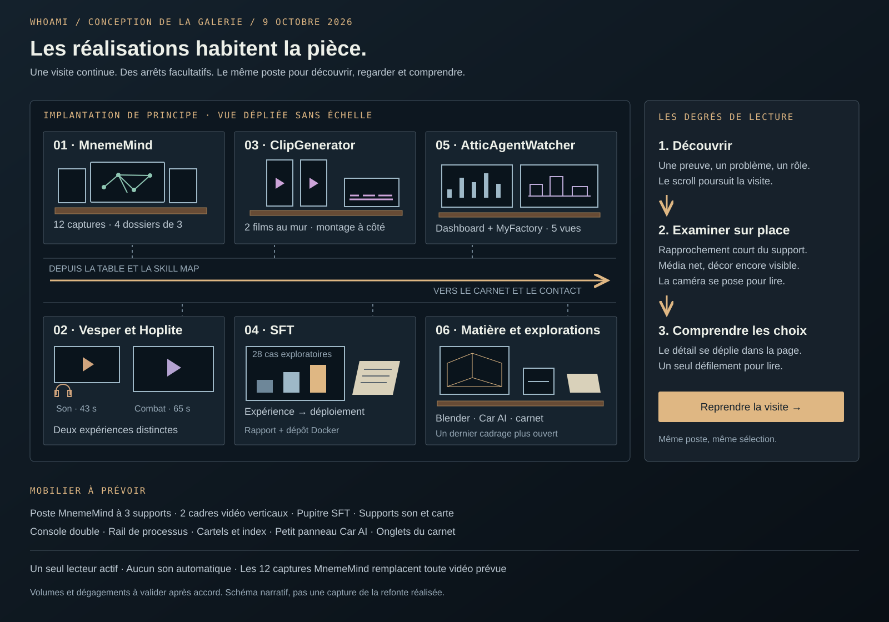

# Scénario détaillé de la galerie du portfolio de Tom Buzon

> Mise à jour après validation : l’implémentation est autorisée. Ordre retenu : MnemeMind → AtticAgentWatcher → ClipGenerator → SFT → Blender → Car AI → Vesper → Hoplites → explorations. Le document ci-dessous conserve la proposition de conception ; le [bilan d’implémentation](implementation.md) décrit le résultat et les adaptations.

La galerie prolonge l'atelier personnel avec des installations où les images, les vidéos et les documents sont visibles pendant la visite. Chaque poste permet de comprendre un projet rapidement, puis de s'y arrêter pour examiner ses réalisations et ses décisions. Cette proposition du 9 octobre 2026 précise le contenu, les déplacements et les éléments à ajouter. **Elle ne constitue pas une implémentation du site.**

La [proposition générale](proposition.md) décrit le profil, la méthode et les compétences. Le parcours principal reste **bureau → table de travail → galerie**. La boucle **Understand → Build → Test → Learn → Iterate** donne du sens aux réalisations : on y retrouve des besoins, des choix, des essais et parfois une idée à remettre en question.

## Disposition et continuité de la visite

Conserver le plancher, les poutres, la lumière chaude et les ouvertures du grenier. L'allée centrale de la galerie reste perceptible dans chaque cadrage. Les postes se répartissent dans six travées, sur ses côtés ; le dernier regroupe des travaux plus courts. On aperçoit toujours un élément du poste suivant. Un mince rail en laiton porte les titres et les repères de chapitre ; la lumière des lampes guide le regard sans créer un tapis de néons.

| Travée | Ce qu'on aperçoit en arrivant | Mouvement principal | Ce que le visiteur comprend |
| --- | --- | --- | --- |
| 1 · MnemeMind | Grand écran Explore, deux panneaux secondaires et index de quatre dossiers | Arrivée de trois quarts, rapprochement court, arrêt presque frontal | Transformer des informations dispersées en espace de travail |
| 2 · Vesper et Hoplite | Coin d'écoute d'un côté, écran de gameplay de l'autre | Translation dans l'allée ; deux cadrages de trois quarts séparés par un petit déplacement | Deux manières différentes d'explorer perception, espace et interaction |
| 3 · ClipGenerator | Deux affiches verticales éclairées au mur ; poste de montage dessous | Approche oblique qui révèle les deux résultats, puis cadrage stable | Voir ce que le système produit et comprendre sa fabrication |
| 4 · SFT | Panneau d'expérience, schéma de déploiement, rapport sur pupitre | Translation courte ; regard sur le panneau puis sur le pupitre si sélectionné | Expérimenter, comparer puis rendre un modèle utilisable |
| 5 · AtticAgentWatcher | Dashboard et écran MyFactory côte à côte | Léger arc vers la console, sans rotation complète | Rendre une activité d'agents compréhensible et revoir l'architecture quand nécessaire |
| 6 · Blender, Car AI et explorations | Rendu accroché, petite surface technique et carnet | Plan plus large, puis arrêt ; les détails courts se lisent depuis ce cadrage | Une pratique qui relie logiciel, image, espace et objets |

Le mobilier existant fournit le vocabulaire commun ; les proportions et les supports changent selon le média. Les postes ne sont pas six copies du même écran. Le dernier plan laisse voir les réalisations et une partie de l'atelier ; les liens de contact concluent sans refaire le trajet en sens inverse.

La scène actuelle contient quatre principaux emplacements dans l'aile droite. Six travées demandent de redistribuer les clones et de déplacer les cloisons ou supports. Le premier travail autorisé après validation sera une implantation avec des volumes simples : confirmer les dégagements et, si nécessaire, allonger légèrement cette aile. La proposition ne suppose pas que tous les nouveaux objets tiennent déjà aux coordonnées actuelles.

Les déplacements accompagnent le scroll et restent réversibles. Ils occupent la transition entre les textes. Pas de vol à travers les écrans, de rotation à 180 degrés pour lire le poste opposé, ni de trajet imposé de deux écrans avant chaque réalisation. Les distances exactes dépendront des volumes ; les inspections visent un arc court, généralement inférieur à 20 degrés, et une transition de 350 à 500 ms. Avec mouvement réduit, un changement de cadrage discret remplace le déplacement.

## Approfondir un projet sans perdre la visite

Trois degrés de lecture se complètent. Le premier suffit pour parcourir toute la page ; les deux autres s'ouvrent à la demande.

**Découverte.** La pièce montre une preuve dominante, le nom, une phrase de problème, le rôle et le statut. Des boutons HTML explicites permettent d'examiner les médias ou de comprendre le projet. Continuer à scroller rejoint simplement le poste suivant.

**Consultation au poste.** Cliquer une affiche, une vignette ou son bouton rapproche légèrement la caméra du support choisi. L'image conserve son cadre dans la pièce. Une fois le cadrage posé, un média HTML net remplace l'affiche de la scène : les petites écritures deviennent lisibles et les contrôles vidéo restent ordinaires. Les miniatures et leurs légendes apparaissent sous le média. Le décor est calme, la caméra reste fixe pendant les changements de capture. Le visiteur ne doit jamais déplacer un personnage ou viser précisément un écran pour agir.

**Lecture du projet.** « Comprendre le projet » déplie sous ce poste un chapitre dans le document principal : besoin, décisions, réalisation, résultat et apprentissage. La caméra reste sur l'installation pendant la lecture. Le média peut rester visible en haut au début, puis laisser la place au texte quand la lecture devient longue. Une colonne d'environ 60 à 70 caractères, posée sur un fond calme, évite de couvrir chaque phrase d'effets 3D. Les images détaillées réapparaissent au bon endroit dans le raisonnement.

Il existe toujours **un seul défilement vertical pour lire**. Le détail ne contient pas son propre ascenseur. La navigation entre captures utilise des boutons, des miniatures et le clavier, sans voler la molette. Un agrandissement plein écran reste disponible pour un schéma ou une capture, avec fermeture et retour du focus ; il ne devient pas l'interface normale de chaque projet.

### Un exemple complet avec MnemeMind

1. Le visiteur arrive devant Explore et comprend en une phrase le besoin d'organiser et retrouver ses connaissances.
2. Il choisit « Explorer les 12 captures ». La caméra se place devant le poste ; le dossier « Relier les idées » est sélectionné.
3. Il ouvre « Retrouver le fil dans le temps » puis la vue des tâches. Seul le contenu des supports change. La sélection indique « Capture 6 sur 12 » et garde le titre de l'image.
4. Il choisit « Comprendre les choix ». Le récit se déplie dans la page ; l'écran reste sur les tâches et le paragraphe correspondant est repérable.
5. « Reprendre la visite » referme le détail et le replace devant MnemeMind, avec sa sélection conservée. « Continuer vers AtticAgentWatcher » l'amène directement au poste suivant. Il n'a pas à remonter tout le texte.

Une petite indication persistante nomme le contexte : « MnemeMind · Consultation » puis « Reprendre la visite ». L'index Work reste disponible. Ouvrir le menu ne réinitialise rien.

### Contrat de navigation à réaliser

La visite, la consultation et le détail sont des états distincts. Lors d'un approfondissement, enregistrer projet, position dans la visite, cadrage, dossier, capture, temps vidéo et bouton déclencheur. L'ouverture suspend le déplacement automatique de la caméra ; le scroll continue à servir la lecture. La sortie referme le chapitre, recalcule les repères du parcours et restaure la position dans un même changement visuel pour éviter un saut vers le poste suivant.

Le bouton Retour du navigateur ferme l'approfondissement ouvert depuis la visite. Changer de miniature remplace la sélection courante sans ajouter douze étapes à l'historique. Un lien direct vers un projet ouvre immédiatement sa version éditoriale ; « Rejoindre la visite » l'amène au même poste. Une section ne se referme pas spontanément au milieu d'un scroll. À sa fin, le passage explicite au projet suivant remet la caméra dans le parcours principal.

Escape ferme d'abord un média agrandi ; il ne doit pas interrompre de manière surprenante les contrôles natifs d'une vidéo. Hors lecteur, Escape peut refermer l'approfondissement et rendre le focus au déclencheur. Sur mobile, les mêmes choix existent dans une composition verticale sans dépendre de la précision d'un clic 3D.

## Les douze captures de MnemeMind

L'installation prend la forme d'un bureau de recherche : un grand écran central, deux panneaux latéraux peu inclinés, un index posé sur le bord du bureau. **Quatre dossiers contiennent trois captures chacun.** Les douze images sont accessibles dès l'entrée en consultation, avec leurs titres, sans devoir finir un dossier pour atteindre le suivant.

À distance, la vue Explore occupe le grand écran. Les panneaux montrent les deux autres vues du premier dossier. En consultation, choisir une image la place en grand au centre ; les deux autres deviennent des aperçus. Le cadre du poste et la légende restent stables. L'index des quatre dossiers joue le rôle d'un petit meuble de classement, dont les contrôles lisibles sont en HTML.

| Dossier | Images affectées | Ce que racontent les légendes |
| --- | --- | --- |
| Relier les idées | 1. Balises ; 2. Explore dans l'application ; 3. Explore en plein écran | Structurer une note, retrouver ses relations, élargir la vue |
| Retrouver le fil dans le temps | 4. Calendrier hebdomadaire ; 5. Calendrier annuel ; 6. Gestion des tâches | Retrouver le contexte d'une semaine, voir une période plus longue, reprendre une action |
| Penser dans plusieurs formats | 7. Excalidraw ; 8. Mermaid, audio et transcription ; 9. Voix | Associer texte, diagramme, dessin et contenus sonores dans le même travail |
| Interroger ses connaissances | 10. IA locale et embeddings ; 11. Réponse de l'IA locale ; 12. Import | Préparer la recherche, consulter la réponse, comprendre comment les données entrent dans le système |

La troisième image du dernier dossier porte une mention visible : **Import — fonction à reconnecter après régression**. Le texte de l'IA locale précise la dépendance actuelle à Ollama. MCP, AppServer et l'adaptation aux agents restent dans un encadré « Évolutions prévues », distinct des captures des fonctions existantes.

Le déroulé principal ne force pas douze arrêts. Il montre Explore, puis suggère que l'information peut se retrouver dans le temps et devenir une action ; trois images choisies suffisent à cette première lecture. Les neuf autres conservent leur place explicite dans les dossiers. Il n'y a ni défilement automatique de diaporama ni vidéo simulée à partir des captures. **Aucune vidéo MnemeMind n'est attendue.**

Le détail éditorial explique ensuite l'origine du besoin, le choix du Markdown enrichi, les relations entre temps et tâches, puis l'IA locale et les évolutions. Il réutilise les mêmes médias et sélections ; il ne crée pas une seconde galerie à parcourir depuis zéro. Les recadrages pédagogiques sont proposés en complément d'un accès à la capture entière.

## Le coin de Vesper et le poste Hoplite

**Vesper commence par une relation humaine.** Proposition de texte à travailler avec Tom :

> Quand mon meilleur ami a perdu la vue, j'ai cherché une activité que nous pourrions partager à égalité.
>
> Vesper explore cette idée à travers le son et le déplacement dans un vaisseau envahi d'extraterrestres. Le prototype m'a confronté à une limite : retirer la vue ne suffisait pas à créer une expérience amusante.

La petite lampe éclaire le casque et le texte d'introduction. La vidéo occupe un écran horizontal ; une affiche titrée annonce la dimension sonore pour qu'un écran sombre ne semble pas en panne. À côté, la carte développeur montre l'organisation spatiale. L'ambiance reste celle du grenier : le visiteur du portfolio n'est pas lui-même plongé dans le noir.

« Écouter l'expérience · 43 s » ouvre le lecteur, avec son sur action volontaire. Une transcription sera préparée à partir de l'audio réel ; la carte est identifiée comme outil de développement et ne devient pas une prétendue vue du joueur. Le détail déroule intention, principe, prototype et apprentissage. Il ne revendique ni test effectué avec l'ami, ni multijoueur implémenté, ni accessibilité démontrée. La phrase de bilan exprime le retour de Tom sur ce prototype.

**Hoplite conserve une identité distincte.** Le regard se déplace vers un écran plus large, déjà visible dans la même travée. L'affiche provient de l'extrait de combat retenu. « Voir le gameplay · 1 min 05 » lance l'extrait 00:43–01:48 après son encodage. Une étagère ou un rail sous l'écran porte les étapes concept → modèle → rig → animation → combat. Les étapes sans exports restent des légendes de processus ; elles ne reçoivent pas de fausses images de production.

Vesper et Hoplite partagent le thème des systèmes interactifs, mais le changement de projet reste nommé. Le premier ne sert pas d'introduction marketing au second. Les deux lecteurs sont indépendants et jamais simultanés.

## Le mur de ClipGenerator

Les deux clips de 478 × 850 occupent **deux cadres verticaux au mur**, séparés par un intervalle réel, avec un éclairage commun. Leurs affiches sont visibles depuis la travée précédente. Chaque cadre porte son bouton de lecture et sa durée : environ 54 s et 1 min 04. L'établi au-dessous reprend l'écran de montage existant, avec une bande de scènes.

L'approche révèle d'abord les résultats. Quand le poste devient actif, les boutons sont clairement disponibles ; ils existent aussi dans le contenu HTML pour le clavier et le mobile. Cliquer une vidéo rapproche et oriente la caméra vers son cadre. Le lecteur occupe environ 320 à 420 px de large sur ordinateur, dans la limite de la hauteur disponible. Le deuxième écran reste visible avec son affiche. Le plein écran natif reste facultatif.

Choisir l'autre clip met le premier en pause et conserve son temps de lecture. Repartir dans la visite met aussi la lecture en pause. Revenir permet de reprendre. Les deux vidéos ne se lancent jamais automatiquement pendant le scroll.

« Voir la fabrication » dirige le regard vers le poste de montage. Cinq captures d'interface détaillent analyse audio, scènes, animation, narration et montage. La sixième, le terminal de démarrage, figure dans le volet technique. Les légendes relient étape et résultat, sans prétendre que le clic sur une capture pilote réellement l'application. Aucune synchronisation précise entre une scène de vidéo et une capture n'est promise sans vérification.

Les noms FrameForge encore présents dans les captures reçoivent une note d'ancien nom. Les défauts de texte observés dans les vidéos sont signalés comme sorties de prototype si aucun nouvel export n'est fourni. Ils ne bloquent pas cette installation et les fichiers originaux restent intacts.

## Le poste SFT

Un panneau mural présente le problème et les trois résultats, avec leur base de comparaison visible : **35,7 % → 53,6 % → 60,7 %, sur 28 cas, benchmark interne exploratoire**. Le pupitre inférieur porte le rapport et les deux actions « Lire l'étude » et « Code de déploiement ». Le petit schéma voisin mène modèle → service d'inférence → interface de démonstration.

Le détail suit le pivot de données, les essais SFT/DPO, le choix du packaging puis le déploiement. Les neuf séquences du dessin Excalidraw servent de matière à des schémas lisibles au bon moment, sans imposer neuf panneaux physiques.

Le [dépôt medicalTriageDocker](https://github.com/Tom-Buzon/medicalTriageDocker) décrit une démonstration avec vLLM sur CPU, API compatible OpenAI, Streamlit et Nginx. Ce lien documente le **déploiement**. Le rapport local porte les détails de l'expérimentation ; les performances GPU du rapport ne sont pas attribuées à la démonstration CPU. Aucune exécution distante du modèle n'est déclenchée depuis le portfolio.

Le cas d'organisation est fictif, l'expérimentation technique est réelle et les budgets sont simulés. Ces distinctions restent proches des éléments concernés. La conclusion porte sur le travail d'ingénierie et les limites du benchmark, sans présenter le prototype comme un outil clinique validé.

## AtticAgentWatcher et les réalisations courtes

**AtticAgentWatcher.** La console associe un écran dashboard et un écran MyFactory. Une petite platine de sélection donne accès aux cinq vues : activité du jour, consommation/cache, sept jours, MyFactory, configuration. Le dashboard est principal à l'arrivée ; choisir MyFactory le place au centre sans déplacer la console. Le statut **POC validé — passage en production en cours** reste visible. Les images restent présentées comme captures du POC sous son ancien nom MyAgents. Aucun compteur ne simule des agents en direct. Le détail raconte la révision de la stratégie d'intégration et distingue l'existant de l'architecture cible.

**Blender.** Le rendu réel occupe un grand cadre accroché. L'approche oblique fait apparaître son volume dans le décor, puis une vue frontale permet d'examiner proportions, matériaux et lumière. Un clic agrandit l'image. La fiche courte ne nécessite pas un long déplacement ni une reconstitution 3D non fournie du fichier Blender.

**Car AI.** Le coin d'établi montre un petit schéma caméra → interprétation → mouvement et une étiquette « Jouet physique augmenté ». Aucun modèle réaliste de voiture n'est utilisé comme preuve du prototype. Une photo ou une vidéo réelle pourra prendre place sur un support du même poste si elle devient disponible ; le contenu prévu aujourd'hui reste le schéma et l'explication technique documentée.

**Explorations.** Un carnet à onglets sert de motif d'ouverture au répertoire HTML. Les dix entrées se consultent par titres et disclosures. Il ne faut pas tourner dix pages en 3D pour les lire. Le dernier plan ouvre sur les opportunités recherchées et LinkedIn.

## Éléments à réutiliser et éléments à ajouter

Le tableau décrit des éléments de scène à prévoir, pas des actifs déjà produits. Les cadres partagent une géométrie commune avec plusieurs proportions ; les supports utilisent les matériaux existants. Les quantités sont un premier périmètre de conception à vérifier lors de l'implantation.

| Installation | Réemploi | Ajouts proposés | Médias ou contenus préparés séparément |
| --- | --- | --- | --- |
| Ensemble de la galerie | Charpente, plancher, fenêtres, lampes, matières et allée | 1 système de rails et cartels, décliné en 6 travées ; repositionnement des supports | Noms, rôles, statuts, index de navigation |
| MnemeMind | Bureau et réseau décoratif comme rappel du projet | 1 composition de 3 supports, dont l'écran principal réemploie un écran existant ; 1 index à 4 dossiers | 12 captures responsives, 12 légendes, miniatures et vues entières |
| Vesper | Poste son, casque, lampe | 1 support vidéo adapté au ratio et 1 porte-carte distinct | 1 affiche, vidéo 43 s, carte développeur, transcription |
| Hoplite | Écran et éléments de l'établi de modélisation | 1 rail de processus sous l'écran | 1 affiche, extrait 65 s, légendes des étapes |
| ClipGenerator | Établi de montage et éléments de timeline | 2 cadres muraux verticaux et leur support commun | 2 affiches, 2 lecteurs, 6 captures et leurs légendes |
| SFT | Tableau de travail ou panneau existant | 1 pupitre de rapport et 1 petit support de schéma de déploiement | Comparaison, schémas dérivés, rapport, lien GitHub qualifié |
| AtticAgentWatcher | Base de console et écrans réaffectés | 1 support double pour dashboard/MyFactory ; 1 platine de sélection | 5 captures, 5 légendes, histoire du changement d'architecture |
| Blender | Cadre mural et lumière | Adaptation des proportions du cadre, sans meuble supplémentaire | Rendu WebP entier, agrandissement et texte court |
| Car AI | Extrémité d'établi | 1 petit panneau technique | Schéma documenté ; aucun faux média matériel |
| Explorations | Carnet et bibliothèque existants | Onglets du carnet | 10 notices HTML |

Les ajouts concernent donc surtout les **supports de consultation**, le pupitre et la signalétique. Les éléments d'ambiance nécessaires existent déjà. Aucun personnage, objet mécanique complexe, nouvelle pièce fermée ou collection d'accessoires génériques n'est nécessaire au scénario.

## Lisibilité et budget de chargement

Le support 3D porte une affiche légère pendant l'approche ; la version lisible charge au moment de consulter le poste. Une capture entière de logiciel ne doit pas rester une petite texture en perspective. Une transition vers le média HTML au cadrage stable conserve à la fois l'intégration dans la pièce et la netteté.

Un seul lecteur vidéo fonctionne à la fois. Les vidéos sont chargées sur action, avec une affiche ; quitter le poste ou masquer l'onglet les met en pause. Les miniatures du poste suivant peuvent être préparées, mais ni les douze captures pleine définition ni les quatre vidéos ne sont chargées avec la hero. Une petite réserve de ressources actives évite de conserver tous les médias en mémoire graphique.

Sur mobile, le poste est un cadrage d'ambiance peu animé et les médias passent au premier plan dans le flux HTML. Les douze captures et les détails restent tous disponibles. Le mode sans mouvement et le repli sans WebGL racontent la même chose. Les titres, boutons et légendes ne dépendent pas du canvas, et les animations de décor s'arrêtent pendant la consultation.

## Correspondance des captures MnemeMind

Les numéros ci-dessous correspondent au tableau des quatre dossiers. Les fichiers originaux ne sont ni renommés ni modifiés. Cette affectation sert à préparer ultérieurement les dérivés du site et leurs légendes.

| Nº | Capture source |
| --- | --- |
| 1 | [Balises](../portfolio-materials/sources/MnemeMind/images/d3cbcb48e8e93e585f8d66173904f353672d2d00063490a8c90c0025620d1f39.png) |
| 2 | [Explore intégré](../portfolio-materials/sources/MnemeMind/images/e0d9bfd8a39b61ebf1e4c032c52ed5ad2ada87f5fbbc4f49ddebd3d3d1ae52b3.png) |
| 3 | [Explore plein écran](../portfolio-materials/sources/MnemeMind/images/f11acca33bb58d7fdbc95b8f27db8561664bd9ffee29bc7a6203114dcbf392fb.png) |
| 4 | [Calendrier hebdomadaire](../portfolio-materials/sources/MnemeMind/images/eb9f4fcae2502070b62fecc0b36ae50c6806bfbc0b3fd85860b6bc3dc1847d77.png) |
| 5 | [Calendrier annuel](../portfolio-materials/sources/MnemeMind/images/05afa04e9af9a59cb46549b4ee121c9656e7a857f48eb81e7d6b17a4863b0521.png) |
| 6 | [Gestion des tâches](../portfolio-materials/sources/MnemeMind/images/7e0929e251697c1566e729886fd840e46908c8cb395aa14f5e71080942b42ccb.png) |
| 7 | [Excalidraw](../portfolio-materials/sources/MnemeMind/images/984f45066a64352ede99073bbf6a37d540fe0b926146d5b4ab93e3d97074ddba.png) |
| 8 | [Mermaid et audio](../portfolio-materials/sources/MnemeMind/images/48ad845e5bbd0da9371258f9c551bf6f2219e5c9bb34d291162fe565c2476633.png) |
| 9 | [Voix](../portfolio-materials/sources/MnemeMind/images/441b3de023d37f329fbd08d5d22b72fd23fa6a50221193d9dc9400a508947909.png) |
| 10 | [IA locale et embeddings](../portfolio-materials/sources/MnemeMind/images/af7506a516add97ba95d6d36d425af1c3c60264d386e7cd8af8b6117f6a6bdf7.png) |
| 11 | [Réponse IA locale](../portfolio-materials/sources/MnemeMind/images/7b4019db5517f4f4fa6965d1cc9cb27f8b447b1d3efe0c6fcb135bb3b4bcf76a.png) |
| 12 | [Import à reconnecter](../portfolio-materials/sources/MnemeMind/images/e270db2b7cb8da6200100fc5c416fb8eab2be24458dae7463583ef95192178c8.png) |

## Première réalisation après validation

Valider d'abord les six travées avec des volumes simples et deux postes représentatifs : MnemeMind pour la profondeur de consultation, ClipGenerator pour les vidéos dans le mur. Ils permettront de vérifier la netteté, les mouvements, la continuité du scroll et le retour à la visite avant de détailler les autres meubles.

Les critères d'acceptation sont concrets : accès aux douze captures, deux clips lisibles volontairement dans leur cadre, aucun son automatique, retour au même poste et à la même sélection, liens directs de projet utilisables, lecture mobile et clavier complète. La version finale des textes et les dérivés médias viennent ensuite.

**Cette réalisation attend la validation de Tom. Seuls les documents et les schémas de conception sont produits à cette étape.**
