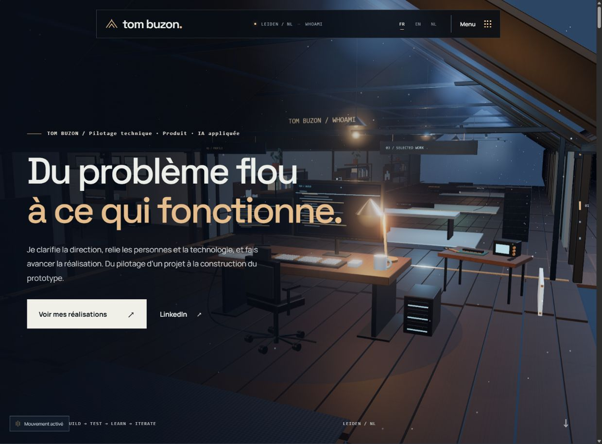
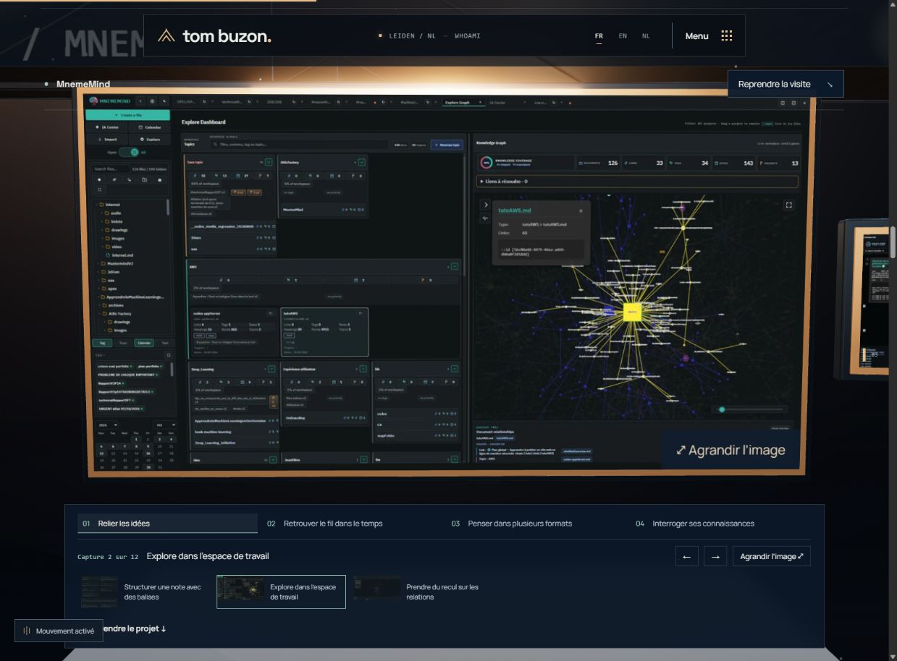

# WhoAmI — bilan d’implémentation

Implémentation locale du 9 octobre 2026 après accord explicite de Tom. La dernière correction de parcours prime sur la numérotation des documents de conception : **MnemeMind → AtticAgentWatcher → ClipGenerator → SFT → Blender → Car AI → Vesper → Hoplites → explorations**.

## Résultat

- Page personnelle Tom Buzon, profil, méthode Understand / Build / Test / Learn / Iterate, carte de vingt compétences, galerie et contact LinkedIn / email.
- Grenier conservé, aile de galerie allongée, huit poses de lecture. Réutilisation des bureaux, lampes, casque et maquette ; nouveaux panneaux, rails, cadres et pupitre. L’objet de la méthode évolue en cinq étapes.
- Médias HTML projetés sur les vrais cadres 3D : images nettes et commandes vidéo natives. Sur téléphone, mouvement désactivé ou sans WebGL, les médias reviennent dans le flux HTML.
- 12 captures MnemeMind, 5 AtticAgentWatcher, 6 ClipGenerator ; deux productions verticales au mur. Carte Vesper et rendu Blender réutilisés.
- Lecture vidéo volontaire, exclusive, pause en quittant le poste ou l’onglet. Vesper complet et Hoplites de 00:43 à 01:48 (65 s). Aucun original modifié.
- Inspection avec catégories, miniatures, précédent / suivant et agrandissement 100 %. Les commandes restent dans la fenêtre de consultation sur ordinateur.
- Fiches dépliées dans la page, sans défilement vertical imbriqué. Retour à la position et sélection précédentes ; fermeture au bouton Retour du navigateur ; URL directe par projet avec accès à la visite complète.
- SFT : comparaison Base / SFT / DPO, rapport complet, dépôt étiqueté « Code de déploiement », neuf séquences adaptées du schéma Excalidraw. Packaging, expérimentation réelle, hypothèses de budget et recommandations restent distincts.
- Les trois répliques de LIA et la consigne visibles dans la capture Vesper sont retranscrites sous le lecteur. Il s’agit du texte affiché dans le jeu, pas d’une transcription certifiée de toute la piste sonore. Une piste de sous-titres synchronisés reste un enrichissement possible.
- Textes FR / EN / NL. 33 documents pré-rendus : accueil, huit projets et deux anciennes adresses dans les trois langues. Les anciennes adresses agence / portfolio rejoignent les bons actes de la page.

## Vérifications

- `npm run lint` : OK.
- `npm run build:pages` : OK, 33 documents pré-rendus. Le module Three.js conserve un avertissement Vite de taille (> 500 Ko non compressé) ; il est chargé séparément.
- `npm test` : 28 tests réussis, dont 9 pour langues, liens, médias, projection et trajectoires ; les 19 tests existants du backend préservé passent aussi. Le chatbot n’est plus rendu dans le site.
- Contrôles dans le navigateur : hero, menu, carte de compétences, inspection MnemeMind, sélection entre familles, agrandissement, fiches, retour à la visite, URL anglaise directe, retour depuis cette URL, vidéos ClipGenerator et pause exclusive / en quittant le poste, lecture mobile et mouvement désactivé.
- Empreintes SHA-256 des 35 fichiers originaux de collecte : toutes inchangées.
- Lecture de Vesper (43,3 s) et Hoplites (65 s) vérifiée dans le navigateur mobile ; contrôles au clavier opérationnels. À 390 px CSS, largeur du document égale à celle de la zone visible. Le changement de mouvement conserve le poste et son décalage dans la fenêtre.
- Hoplites web : 1120 × 624, 30 images/s, 65 s, environ 21 Mo, téléchargement seulement à la demande du lecteur. Les autres vidéos restent également en `preload="none"`.

## Fichiers d’édition

- `src/content/copy.js` : textes personnels et méthode.
- `src/content/projects.js` : projets, statuts, légendes et récits.
- `src/content/skills.js` : compétences et explorations.
- `src/content/sftEvidence.js` : adaptation éditoriale des neuf séquences SFT.
- `src/scene/tour.js` : trajet principal et calcul de progression.
- `src/scene/gallery.js` : mobilier des postes, surfaces et cadrages de consultation.
- `src/components/ProjectStage.jsx` : lecteurs, galerie et études de cas.
- `scripts/prepare-portfolio-media.py` : dérivés web, avec vérification préalable des sources.

Aucun déploiement ni push effectué. L’aperçu de production est servi localement sur `http://127.0.0.1:4173/M-IA/` pendant la revue.

