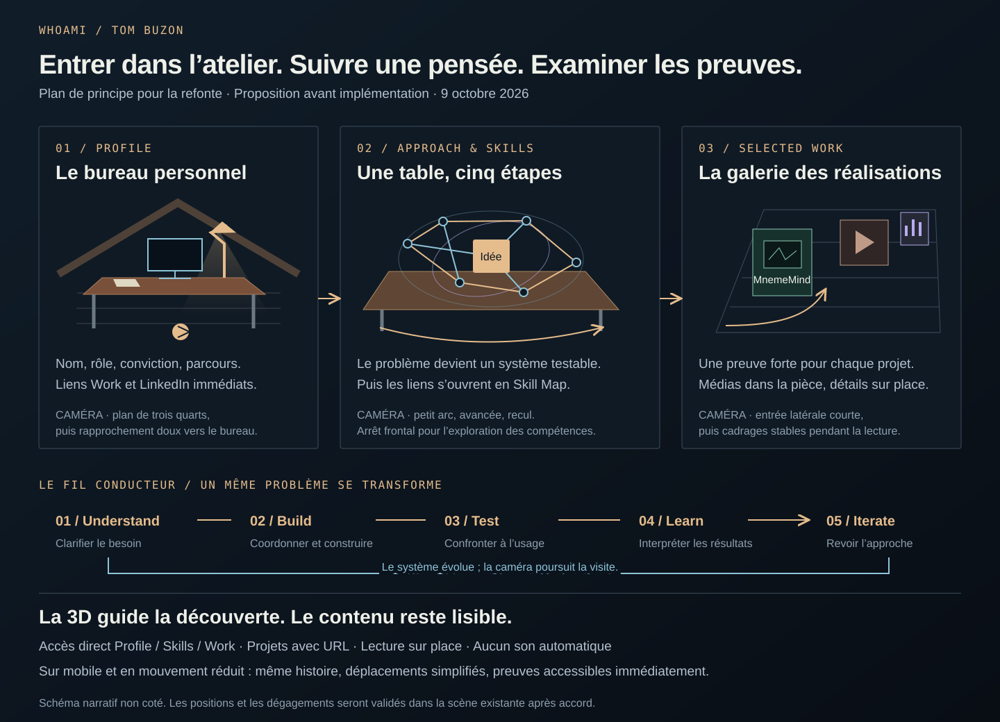

# Proposition de refonte WhoAmI et audit du site

> Mise à jour après validation : l’implémentation est autorisée. Ordre retenu : MnemeMind → AtticAgentWatcher → ClipGenerator → SFT → Blender → Car AI → Vesper → Hoplites → explorations. Le document ci-dessous conserve la proposition de conception ; le [bilan d’implémentation](implementation.md) décrit le résultat et les adaptations.

Proposition du 9 octobre 2026, actualisée avec les précisions de Tom sur son positionnement, Vesper, les médias et le dépôt SFT. Périmètre : audit et direction créative, avant implémentation. Aucun changement du site n'est réalisé dans ce dossier. Le [scénario détaillé de la galerie](galerie-detaillee.md) précise les installations à ajouter et les parcours de lecture.

L'expérience proposée présente Tom Buzon comme une personne capable de comprendre un problème ambigu, de choisir une approche, de construire et d'évaluer une solution. Elle conserve le grenier, le bureau, la lumière et le langage de mouvement existants. Elle rassemble Profile, Approach & Skills et Selected Work dans une visite continue, avec accès direct aux projets.

**Idée directrice : entrer dans ton atelier, suivre une pensée qui prend forme, puis examiner ce que tu as réellement construit.**

## Positionnement et premier écran

L'identité principale devient **Tom Buzon**. WhoAmI peut rester la signature discrète de l'expérience. Le nom d'une agence ne doit plus occuper la première lecture.

Proposition de texte de travail pour la hero anglaise :

> **TOM BUZON**
>
> Strategy, technology & hands-on delivery
>
> **From unclear problems**
> **to things that work.**
>
> I help define the direction, bring people and technology together, and get things built — from coordinating delivery to designing systems and building prototypes.
>
> Understand → Build → Test → Learn → Iterate

Adaptation française : « D'un problème flou à quelque chose qui fonctionne. » Le texte sera travaillé avec Tom avant sa version finale. Deux actions visibles : **Voir mes réalisations** et **LinkedIn**. La suite du parcours reste accessible par le défilement et un lien discret « Ma démarche ». La place de l'IA est précisée dans le profil : un outil puissant pour travailler, dont l'usage dans la solution dépend du besoin.

La composition reprend celle de la Home : texte à gauche, bureau éclairé à droite, profondeur de la charpente derrière. Le nom et le rôle sont lisibles immédiatement. La révélation typographique concerne l'accroche, avec le rythme existant ; elle ne conditionne jamais l'accès aux boutons. Aucun écran de chargement obligatoire.

Le parcours personnel suit dans un bloc court, pendant que la caméra se rapproche du bureau :

| Expérience | Ce qu'elle apporte au récit |
| --- | --- |
| Développement web chez JPSI, avril 2020 à avril 2022 | Construire des interfaces et des applications |
| Assistant Project Controller à l'ESA, juillet 2022 à décembre 2024 | Planification, suivi et reporting dans des programmes complexes |
| Product Owner / Product Builder chez JPSI, janvier à décembre 2025 | Passer du besoin à un outil de gestion des tâches déployé auprès d'utilisateurs |
| Reconversion et projets indépendants en IA | Expérimentation, systèmes de connaissance, agents et prototypes ; Master annoncé pour octobre 2026 |

Les périodes de formation, d'emploi et de recherche peuvent se chevaucher : la présentation ne les transforme pas en étapes artificiellement exclusives. Le diplôme reste « en cours de validation » tant que son obtention n'est pas confirmée. Le parcours ESA reste du **contrôle de projet**, sans attribution d'un rôle d'ingénieur spatial.

Le **pilotage de projets techniques** et la **construction** occupent une place égale. Le profil rend explicites les opportunités recherchées : Technical Project Management, AI/IT Delivery, Product Ownership et Solution Engineering. Les preuves restent précises : contrôle de projet à l'ESA, conception et livraison du système de tâches chez JPSI, architecture et prototypes personnels. Ces responsabilités ne deviennent pas rétroactivement un intitulé de chef de projet à l'ESA. Le système de tâches JPSI constitue une preuve professionnelle dans le profil ; il n'est pas assimilé à l'archive « Recommendation Task Tool » à retirer.

## Audit de l'existant

### Fondations à conserver

Le site utilise React 18, Vite 6, Three.js, GSAP, ScrollTrigger et Lenis. Les versions exactes installées et les fichiers de verrouillage resteront la référence lors de l'implémentation. Il n'existe pas de raison démontrée de changer cette stack.

Le site actuel est une application à **neuf entrées HTML** : Home, Agency et Portfolio, chacune en FR, EN et NL. `main.jsx` choisit une page d'après les attributs du document. Une SPA continue demande donc une évolution de la navigation et des entrées pré-rendues ; assembler les trois composants ne suffit pas.

| Élément | Observation | Décision |
| --- | --- | --- |
| Header, `src/App.jsx` et `src/motion.css` | Barre flottante vitrée, filet fin, point chaud, grille de neuf points, menu plein écran | Conserver géométrie, états et personnalité ; adapter identité et destinations |
| Menu | Ouverture par masque de 500 ms ; entrées de 700 ms avec décalages de 80 et 160 ms ; grille tournant en 400 ms | Conserver ces signatures ; adapter l'état actif aux trois actes |
| `SignalText.jsx` | Décodage sur 420 ms avec les glyphes `_/+·:01`, texte accessible stable séparé du texte visuel | Réutiliser, contrôler le déclenchement par focus du lien parent |
| `useMotion.js` | Titres par mots sur 900 ms, décalage de 35 ms, `power4.out` ; révélations de 800 ms | Préserver la qualité ; éviter de rejouer les titres lors de la fermeture d'une fiche |
| Grenier procédural | Mobilier, charpente, plancher, textures, éclairages et fenêtres déjà construits | Réemployer les objets et matières |
| `tour.js` | Courbes de caméra séparées par page ; progression dérivée des dimensions réelles du HTML | Conserver calcul et interpolation, écrire une seule trajectoire narrative |
| `SpatialPassage.jsx` | Caméra et texte partagent la progression ; passages desktop de 195 svh | Réutiliser le mécanisme, réduire les traversées répétitives |
| Portfolio | Chapitres distincts et palette éditoriale ; exemples parfois illustratifs | Conserver la hiérarchie et remplacer les preuves illustratives principales par les médias réels |
| Archives | Filtres et disclosures natifs | Conserver ce format compact et réécrire l'inventaire demandé |
| Langues et pré-rendu | FR, EN, NL ; HTML pré-rendu ; chemins préfixés avec `publicUrl` | Maintenir indexation, traductions et compatibilité `/M-IA/` |

La scène comprend un atelier central, une aile studio à gauche et une galerie à droite. Les installations mémoire, son, montage et maquette existent au centre puis sont clonées dans la galerie. Les trois pages parcourent ces zones séparément. La réorganisation doit donner une fonction unique à chaque zone visitée et limiter ces doublons.

### Ce qui change profondément

- Les offres, services, FAQ commerciale, formulaire de brief et appels à acheter une prestation sortent de la visite personnelle.
- L'origine du grenier devient un détail biographique ; elle cesse d'expliquer une marque d'agence.
- Les transitions « page suivante » disparaissent au profit des actes d'une seule visite.
- Les inscriptions 3D, le logo textuel, les métadonnées, les légendes et les trois langues sont renommés ensemble.
- Le graphe illustratif Mastermind et le storyboard FrameForge ne servent plus de preuves principales du produit.
- Le chapitre autonome « Give the idea volume » est retiré. SFT prend sa place éditoriale ; Blender garde sa propre présentation concise.
- Attic Factory ne figure pas dans le parcours principal. AtticAgentWatcher conserve son nom de projet demandé, sans être présenté comme une agence.
- Le chatbot est déjà désactivé dans le build GitHub Pages. Sa persona locale reste orientée agence ; elle devra être retirée de l'expérience personnelle ou réécrite avant toute réactivation. Aucun nouvel assistant ni backend n'est nécessaire à cette refonte.

### Lecture probable par audience

Cette grille est une analyse éditoriale, pas le résultat d'une étude utilisateurs chronométrée.

| Visiteur | Site actuel à 5 secondes | À 15 secondes | À 60 secondes | Cible de la refonte |
| --- | --- | --- | --- | --- |
| Recruteur | Agence de build et conseil | Prestations et méthode | Tom apparaît tard, parcours dispersé | Nom et rôle au premier écran ; parcours bref et preuves accessibles directement |
| Ingénieur senior | DA forte, proposition assez générale | Disciplines et promesses | Peu de captures et d'arbitrages techniques visibles | Une fiche donne rapidement le problème, les décisions, les preuves et les limites |
| Entrepreneur ou partenaire | Offre commerciale | Invitation à cadrer une mission | Mélange entre studio et travaux personnels | Comprendre la capacité à faire progresser une idée et à décider de la suite |
| Visiteur curieux | Atelier séduisant | Long parcours narratif | Risque de retenir surtout les effets | Comprendre qu'un même problème évolue et découvrir des réalisations concrètes |

## Réorganisation de l'espace

Trois zones suffisent : **bureau personnel → table de réflexion et de prototypage → galerie des réalisations**.

Le bureau d'entrée reste à sa place. Le mobilier de cadrage de l'aile gauche est rapproché du cœur de l'atelier pour constituer la table de la méthode. Le réseau suspendu existant devient le support visuel d'une transformation puis de la Skill Map. La galerie droite reste perceptible depuis l'atelier et devient l'aboutissement de la visite.

L'aile gauche peut conserver bibliothèque et coin d'échange en arrière-plan, sans imposer un détour. Les postes répétitifs du fond sont redistribués dans les projets correspondants. Les trajectoires exactes, dégagements et cadrages seront validés dans la scène après accord ; les indications suivantes sont un découpage de mise en scène.

## Scénario de caméra et transformation

### Premier tableau — entrer dans l'atelier

Plan de trois quarts proche de la Home actuelle. Au premier plan : une poutre qui cadre sans couper le texte. Au centre droit : bureau, carnet, lampe et écrans. Dans la profondeur : table de travail, puis ouverture vers la galerie. Ambiance bleu nuit et bois, éclairage chaud concentré sur les surfaces de travail.

L'arrivée se limite à une très courte mise en place de la lumière et de la typographie. La caméra ne s'envole pas à l'ouverture. Un faible parallaxe au pointeur peut subsister sur ordinateur, désactivé dès qu'il gêne la lecture. L'écran est déjà composé avant le premier scroll.

### Deuxième tableau — rencontrer la personne

Un travelling lent rapproche le visiteur du carnet et de la chaise, avec un léger déplacement latéral. Le parcours professionnel apparaît dans le HTML, sur une surface calme. Un paragraphe expose le goût des situations 0→1 et la place de l'IA dans le travail : recherche, architecture, prototypage, revue, tests et itérations.

Une phrase de liaison fait entrer dans la méthode : « Ce qui relie ces expériences, c'est ma manière d'aborder un problème. »

### Troisième tableau — suivre un problème qui prend forme

La caméra passe du bureau à la table par une courbe courte dans l'allée. Elle reste ensuite proche de cette même table. Les cinq étapes transforment le même ensemble de fragments, selon la nouvelle boucle de Tom : **Understand → Build → Test → Learn → Iterate**.

| Étape | Transformation de l'objet | Caméra | Information apportée |
| --- | --- | --- | --- |
| **Understand** | Des fragments « besoin », « usage », « contraintes », « informations » sont dispersés ; ils se regroupent autour d'une question centrale | Arrivée de trois quarts, légère plongée, puis palier de lecture | Clarifier pour qui l'on construit et ce qui devrait changer |
| **Build** | Une structure simple émerge ; quelques blocs prennent du volume et rejoignent l'écran de l'établi | Petit arc de 20 à 30 degrés puis rapprochement court | Choisir une approche, répartir le travail, coordonner ou construire le premier périmètre |
| **Test** | Le prototype rencontre trois repères : usage, fonctionnement, contraintes ; un écart reste visible | Caméra presque fixe, léger décalage du regard | Confronter l'idée à des observations ; aucune réussite automatique |
| **Learn** | Un résultat devient une annotation ; une hypothèse perd son lien et une décision reste à réexaminer | Palier stable, recul minime | Expliquer ce qu'on a appris, y compris lorsqu'une idée ne fonctionne pas |
| **Iterate** | Une pièce est déplacée, le système se recompose et un lien revient à la question initiale | Élargissement qui prépare la Skill Map | Modifier le périmètre ou l'approche ; choisir ce qui mérite la suite |

Le contenu 3D est une **illustration de démarche**, pas une démonstration inventée d'une application. Il n'affiche aucun faux benchmark, terminal simulant une vraie exécution ou validation « tout vert ». Les vrais résultats sont montrés dans les études de cas.

Le rythme initial vise environ 2,5 à 3 hauteurs d'écran pour cette séquence desktop, à affiner après mesure. Les transitions se concentrent entre les étapes ; les textes bénéficient de paliers calmes. Défilement réversible, sans scroll-snap et sans durée minimale imposée.

La conception, la communication et la coordination traversent les cinq étapes. Le retour d'Iterate vers Understand est porté par l'objet et un lien lumineux ; la caméra ne refait pas le circuit. Vesper donnera ensuite un exemple concret de Learn ; SFT et AtticAgentWatcher montreront des changements d'approche.

### Quatrième tableau — montrer les compétences mobilisables

Le prototype reste sur la table. Les liens autour de lui s'écartent en quatre familles, reprenant les couleurs et la géométrie de la carte fournie. La caméra se stabilise de face. À la fin de la transition, le SVG interactif HTML prend exactement la place de la représentation décorative : texte net, vraie sélection au clavier, outils et preuves lisibles.

Le passage est court et reste une correspondance visuelle entre les deux représentations. Il ne transforme pas les 20 stations en autant d'objets WebGL à lire en perspective.

### Cinquième tableau — découvrir les réalisations

Le visiteur quitte la table par l'allée visible vers la galerie droite. Un travelling latéral suivi d'une rotation douce fait apparaître le premier panneau MnemeMind. Le langage de lien de la Skill Map devient un simple repère de chapitre : la compétence mène à sa preuve.

La galerie rassemble des postes de travail, des écrans et des documents propres à chaque projet. Les vrais médias apparaissent déjà sur ces supports pendant l'approche. Entre deux projets, un déplacement bref révèle le poste suivant. Pendant la lecture, la caméra se stabilise. Les passages dédiés de 195 svh ne sont pas répétés avant chaque étude.

MnemeMind reçoit un poste à trois surfaces de consultation ; Vesper et Hoplite partagent une travée avec deux cadrages distincts ; ClipGenerator réunit deux écrans verticaux au mur et un établi de montage ; SFT dispose d'un panneau d'expérience et d'un pupitre de rapport ; AtticAgentWatcher utilise une console d'observation ; Blender devient une respiration visuelle ; Car AI garde un petit panneau technique sur l'établi. Le carnet d'explorations ferme la sélection. Les implantations, les douze captures MnemeMind, les ajouts de mobilier et les transitions sont détaillés dans [Galerie détaillée](galerie-detaillee.md).

### Dernier tableau — ouvrir la conversation

Le cadrage s'élargit légèrement sur la galerie et laisse entrevoir l'atelier d'où l'on vient. La lumière chaude sert de rappel au bureau initial. Aucun retour en marche arrière à travers tout le bâtiment.

Texte de travail : « J'aime les équipes qui transforment les questions difficiles en choses que l'on peut essayer. » Liens LinkedIn et e-mail. La recherche d'un environnement où l'IA fait partie des pratiques de l'équipe peut être explicitée ici, avec un ton ouvert.

## Navigation et lecture des projets

Le menu conserve son apparence et sa chorégraphie. Ses trois grandes entrées deviennent **Profile / Skills / Work**, adaptées dans chaque langue. Les aperçus correspondent au bureau, à la table et à la galerie. La barre de progression et le rail indiquent l'acte actif. Les projets sont accessibles aussi par un index de noms visible à l'entrée de Work.

Cliquer sur Work depuis le premier écran amène directement à la galerie. Un fondu court et un nouveau cadrage remplacent le voyage complet. Le visiteur qui veut examiner un projet n'est jamais obligé de regarder la méthode.

Chaque projet possède trois niveaux : **découvrir dans la pièce**, **examiner ses médias sur place**, puis **lire ses décisions et son bilan**. La visite principale donne déjà le problème, le rôle, le statut et un résultat. Tous les approfondissements sont facultatifs.

Lorsqu'on choisit un média, un rapprochement de 350 à 500 ms aligne la caméra sur son support. À l'arrêt, une image ou une vidéo HTML nette prend la place de l'affiche sur l'écran. Le cadre, le mur et l'éclairage restent visibles. Les captures d'un même dossier changent sur le support sans déplacer la caméra à chaque clic. Les commandes sont accessibles aussi par une liste HTML ; viser un objet 3D n'est jamais nécessaire.

« Comprendre le projet » déplie ensuite un chapitre éditorial **dans le document de la visite**, sous le média. La caméra reste au poste, le défilement naturel sert à lire. Un sommaire court et le bouton persistant « Reprendre la visite » gardent le contexte. À la fin du chapitre, « Continuer vers [projet suivant] » permet d'avancer directement. Ce mécanisme remplace la grande fiche superposée comme accès habituel aux détails.

À l'ouverture, mémoriser projet, section, média, position, focus et temps vidéo. À la fermeture, retrouver le cadrage et la place mémorisés, sans rejouer l'introduction. Retour du navigateur ferme l'approfondissement ouvert depuis la visite. Escape ferme en priorité l'agrandissement ou le lecteur actif ; hors lecteur, il referme le chapitre. Les mesures du parcours sont recalculées à l'expansion et à la fermeture pour éviter les sauts vers un autre projet.

Une URL directe affiche une étude de cas immédiatement lisible avec son lien « Rejoindre la visite ». Sur mobile, les médias et les détails restent dans le flux normal ; aucun trajet en caméra ni petit écran en perspective n'est requis. Les lecteurs vidéo conservent leurs contrôles natifs, avec un seul lecteur actif et aucun son automatique. L'agrandissement ponctuel d'une image constitue la seule surface modale supplémentaire.

## Intégration de la Skill Map

La carte originale existe : quatre domaines, vingt stations, filtres, détails et outils contextuels. Sa structure et sa personnalité sont une bonne base. Le HTML autonome sera adapté en composant de l'application, sans iframe avec son propre défilement.

Sur mobile, la carte actuelle est trop réduite : les noms des stations deviennent minuscules au milieu d'une grande zone vide. La version cible présentera les quatre familles sous forme de sélecteurs, puis une liste de stations et leurs preuves. Une mini-constellation conservera l'identité visuelle, sans être le seul moyen de navigation.

La fiche d'une station répond à « Ce que je sais mobiliser », « Où je l'ai appliqué » et « Avec quels outils ». Les liens ne doivent pas transformer la liste d'outils en revendications d'expertise de production.

| Station ou capacité | Lien justifié | Nature de la preuve |
| --- | --- | --- |
| Knowledge workspaces, Retrieval & RAG | MnemeMind ; LocalRag dans les explorations | Markdown enrichi, recherche, sources et IA locale documentés ; portée de l'archive précisée |
| LLM specialization, Model evaluation | SFT | Baseline, spécialisation, comparaison, pivot data et limites |
| Agent observability | AtticAgentWatcher | POC, visualisations et architecture en évolution |
| Audio & voice | Vesper ; MnemeMind | Guidage situé ; documents audio, transcription et voix |
| Video systems | ClipGenerator | Analyse audio, scènes, animation, narration et export |
| Spatial interaction | Hoplite ; Blender | Gameplay et rendu existants ; étapes de création à illustrer lorsqu'elles sont documentées |
| Physical prototypes | Car AI | Prototype de jouet ; preuve matérielle complémentaire requise |
| Problem framing, Full-stack delivery | Expérience JPSI ; MnemeMind | Passage du besoin à un produit ; réalisations personnelles documentées |
| Feasibility, Technical strategy | SFT ; AtticAgentWatcher | Mesures, arbitrages et changements de stratégie |
| Operations & costs | Expérience de contrôle de projet ; section de planification SFT | Expérience réelle distincte des budgets simulés de l'étude SFT |

MCP et AppServer restent des évolutions pour MnemeMind. Les autres harness envisagés ne sont pas considérés connectés à AtticAgentWatcher. La carte conserve ses 20 stations, mais les liens et descriptions sont calibrés selon les preuves disponibles.

## Traitement éditorial du portfolio

### 01 MnemeMind

Fil : **capturer une idée → lui donner du contexte → la retrouver → reprendre le travail**.

La grande capture d'ouverture sera la vue Explore intégrée à l'application : elle montre un véritable espace de travail et ses liens. Les douze captures sont réparties en quatre dossiers de trois images : **Relier les idées**, **Retrouver le fil dans le temps**, **Penser dans plusieurs formats**, **Interroger ses connaissances**. Le poste comprend un grand écran et deux panneaux latéraux. Le visiteur choisit un dossier puis une capture ; une seule image prend la place centrale en grand, les deux autres restent repérables. Le [découpage détaillé](galerie-detaillee.md#les-douze-captures-de-mnememind) affecte chaque fichier à un emplacement et une intention.

La relation entre balises Markdown, calendrier et tâches mérite une courte démonstration pédagogique basée sur les fonctions décrites. Mermaid et Excalidraw montrent que la pensée ne se limite pas au texte. Le RAG local est présenté avec sa dépendance actuelle à Ollama. L'import est explicitement décrit comme une fonction à reconnecter après régression. AppServer, MCP et l'adaptation aux agents restent dans une roadmap séparée.

**Aucune vidéo MnemeMind n'est prévue, conformément au choix de Tom.** Les douze captures constituent le parcours définitif de cette proposition. Aucun lecteur ni emplacement vidéo n'est réservé. L'URL publique et la licence du projet doivent être vérifiées avant d'afficher un bouton de dépôt open source.

### 02 Vesper et Hoplite

Thème commun : **concevoir des systèmes interactifs où perception, comportement et espace comptent**. Les deux projets possèdent leurs propres médias et leur propre fiche ; les vidéos ne sont pas mélangées.

**Vesper.** L'entrée part de l'intention personnelle : « Quand mon meilleur ami a perdu la vue, j'ai cherché une activité que nous pourrions partager à égalité. » Le prototype explore le déplacement et le guidage sonore dans un vaisseau envahi d'extraterrestres. Le bilan reste direct : « Retirer la vue créait une contrainte commune. Cela ne suffisait pas à rendre l'expérience amusante. » Cette phrase expose un apprentissage de conception ; elle ne généralise pas à l'expérience des personnes aveugles. La participation de l'ami à un test, une fonction multijoueur ou une accessibilité validée ne sont pas établies.

Le coin d'écoute comprend la vidéo de 43,3 s, un casque et, à côté, la carte développeur pour comprendre le guidage. Un panneau explique avant lecture que l'image sombre est intentionnelle. Lecture volontaire, casque suggéré, transcription à préparer après écoute. La scène autour reste lisible. Le détail suit intention → contrainte sensorielle → prototype → difficulté de l'expérience → apprentissage, sans transformer le handicap en argument d'horreur ni inventer une réussite.

**Hoplite.** L'extrait demandé est 00:43–01:48, soit 65 s. Les images à 43, 65, 85 et 107 s montrent un combat, de nombreux soldats, un géant et les indications du moniteur de développement. Ces indications ne constituent pas un benchmark reproductible et ne justifient pas une promesse de fluidité généralisée.

La fiche suit concept de personnage → image de référence → modèle → rig → animation → intégration → combat. Le brief décrit cette chaîne, mais les pièces intermédiaires ne sont pas dans la collecte : la frise pourra être expliquée en texte et n'affichera des comparaisons visuelles qu'avec de vrais exports. L'extrait sera préparé après validation du plan ; le fichier original reste intact.

### 03 ClipGenerator

Le nom public est ClipGenerator. Une mention discrète indique que les captures montrent son ancien nom FrameForge.

La présentation met en regard **le pipeline réel** et **ses résultats**. Deux écrans verticaux au mur portent les affiches des vidéos, visibles pendant l'approche. Devant eux, l'établi présente l'interface de montage. Les vidéos deviennent lisibles sur action du visiteur, une à la fois, dans leur cadre ou en plein écran volontaire. Les captures se succèdent dans cet ordre : analyse audio → description des scènes → sélection et ajustement des cartes → animation → narration facultative → vérification du montage. Le terminal de démarrage appartient aux détails techniques.

Les deux productions restent en format vertical, avec une largeur maîtrisée : environ 320 à 420 px sur desktop selon la composition, et toute la largeur utile sur mobile. Elles font 53,5 s et 63,9 s en 478 × 850. La première partage des éléments visuels avec le montage montré dans les captures ; cette relation peut être expliquée. Une correspondance précise scène par scène devra être validée avant de proposer une synchronisation interactive.

La première vidéo affiche le mot « True » à plusieurs instants et des sous-titres semblent manquer d'espaces. La seconde présente aussi quelques collisions de mots. Cela demande un nouvel export pour une présentation finale très soignée ; à défaut, les clips restent honnêtement légendés comme sorties de prototype. Les originaux ne seront pas retouchés pour faire croire à une meilleure sortie du produit.

### 04 Spécialiser un petit LLM

Fil : **une première piste de données inadéquate → un pivot → une expérimentation → un arbitrage de démonstration → une décision de poursuite conditionnelle**.

Le tableau d'ouverture juxtapose les trois valeurs réellement documentées : **35,7 % base ; 53,6 % SFT ; 60,7 % DPO**, avec **28 cas, benchmark interne exploratoire** immédiatement à côté. Le gain est de **25 points**, pas 25 %. Aucune extrapolation clinique ou de généralisation.

La fiche développe Qwen3-1.7B-Base, RTX 4070 8 Go, LoRA et DPO, puis le choix du modèle fusionné FP16. Le comparatif de packaging est séparé de la progression Base/SFT/DPO : il montre notamment 1,21 s de latence moyenne et 30,56 tokens/s pour la variante fusionnée dans cette campagne, sans promettre ces résultats ailleurs.

Trois statuts éditoriaux restent visibles : **réalisé**, **simulation**, **proposition**. Les budgets et jalons pédagogiques ne deviennent pas des budgets réellement pilotés chez un client. Le schéma Excalidraw fourni contient neuf séquences exploitables ; il servira à produire des vues lisibles par partie plutôt qu'une image géante illisible.

Le rapport HTML complet est déjà prêt dans `public/reports/sft/index.html`, ainsi que son Markdown téléchargeable. La fiche donnera accès à `publicUrl('/reports/sft/')`. Le lien **Code de déploiement** mène au [dépôt medicalTriageDocker](https://github.com/Tom-Buzon/medicalTriageDocker), fourni par Tom et consulté le 9 octobre 2026. Son README décrit vLLM sur CPU, une API compatible OpenAI, une interface Streamlit et Nginx. Il illustre le passage du modèle à une démonstration utilisable ; il ne sera pas étiqueté comme dépôt complet de l'entraînement. Les mesures RTX 4070 du rapport restent distinctes des performances de ce déploiement CPU.

### 05 AtticAgentWatcher

Statut : **POC validé — passage en production en cours.**

Ouverture sur le dashboard d'activité du jour, puis consommation/cache et monde MyFactory. La vue de configuration va dans les détails, avec sa limite visible : l'écran montre notamment une consultation sans modification et une configuration à vérifier.

Le récit le plus utile est le changement de stratégie : abandon d'une conversion universelle des configurations, respect des particularités des harness, puis collecte événementielle et récupération historique. Les notes documentent des hooks Codex et un service OTel, tandis que le mapping complet et la récupération sont encore à poursuivre. Le schéma cible OTel/hooks → service → SQLite → interface sera légendé comme architecture en construction, avec les éléments réalisés distingués.

Les captures gardent leur nom historique MyAgents. Les montants affichés sont des équivalents API estimés, pas des économies mesurées ou nécessairement une facture réelle. MyFactory illustre la compréhension de l'activité ; sa vue datée ne promet pas un état live garanti.

### 06 Blender

Une grande image du rendu existant, suivie d'une explication courte sur proportions, matières, lumière et composition. Un futur wireframe ou une vue du modèle permettrait d'enrichir la preuve de modélisation. Aucun carrousel vide si ces pièces ne sont pas disponibles. Le rendu n'est pas présenté comme une photographie.

### 07 Car AI

L'appellation visible précise **jouet physique augmenté par l'IA**. Le schéma montre caméra → interprétation → commande de mouvement, avec les éléments actuellement documentés, dont le Raspberry Pi 4. Aucun capteur supplémentaire n'est inventé.

La collecte ne contient pas de photographie ou vidéo du dispositif. En attendant une preuve matérielle, garder une présentation courte et technique, sans rendre une voiture 3D réaliste qui pourrait suggérer un véhicule autonome abouti.

### 08 Exploration Book

Conserver les disclosures compacts, avec contexte, approche, acquis, état et lien lorsqu'il existe. Liste cible : Chess Agent ; ML Delivery ; UseYourFridge ; PropertyValuation ; MosaicGenerator ; TeachMeAnything ; TradeBroFamily ; LocalRag ; Vision ; Reinforcement Learning.

Vision et Reinforcement Learning deviennent deux entrées. La recommandation et l'outil de tâches sont retirés. CryptoWatch existe dans l'ancien code mais n'appartient pas à la nouvelle sélection : l'exclure de la visite proposée, tout en conservant son historique dans les sources. Les éléments techniques anciens ne deviennent pas des résultats validés par simple reprise.

## Inventaire et stratégie des médias

La collecte contient 23 PNG, 4 MP4, 4 Markdown, 2 dessins JSON, 1 HTML et 1 WAV. Les trois WebP du site ont aussi été examinés. Les planches de lecture sont disponibles dans `previews/` ; elles servent à l'audit et ne sont pas des assets de production.

| Ensemble | Format et qualité utiles | Usage principal | Usage secondaire ou réserve |
| --- | --- | --- | --- |
| MnemeMind, 12 images | PNG, interfaces principalement autour de 2500 × 1300 ; bonne définition mais petits caractères à l'échelle d'une carte | Explore, calendrier et tâches | Notes et diagrammes, RAG, voix ; import avec statut explicite |
| AtticAgentWatcher, 5 images | PNG autour de 1050 × 920 ; tableaux lisibles en grand | Dashboard du jour et MyFactory | Consommation, 7 jours, configuration |
| ClipGenerator, 6 images | Cinq interfaces autour de 2550 × 1365, un terminal 706 × 350 | Pipeline produit et montage | Services locaux dans la partie technique |
| Vesper | MP4 H.264/AAC, 43,3 s, 1096 × 756 ; écran sombre intentionnel | Lecture avec son sur action de l'utilisateur | Carte développeur WebP 1100 × 760 pour expliquer l'espace |
| Hoplite | MP4 H.264/AAC, 252,6 s, 1274 × 710 | Extrait 65 s à encoder | Original conservé localement |
| ClipGenerator, 2 clips | MP4 H.264/AAC, 478 × 850, 24 fps ; défauts de sous-titrage observés | Deux résultats en lecteurs verticaux | Nouvelle exportation souhaitable |
| Blender | WebP 1600 × 1200 | Image éditoriale du rendu réel | Gros plan de matière si le fichier le permet |
| Atelier | WebP 1672 × 941, illustration générée d'ambiance | Repli sans WebGL | Référence de composition, pas une photo du logement |
| Dessin SFT | JSON Excalidraw, 335 éléments | Neuf séquences pour une adaptation lisible | Source intégrale conservée |
| Dessin OPCL | JSON Excalidraw, 168 éléments | Référence de cadrage | Pas une preuve d'intégrations livrées |
| WAV MyAgents | Audio orphelin dans la collecte | Aucun usage prévu | Contenu sonore non audité dans cette phase |

Les images PNG totalisent environ 9,93 Mio et les vidéos 143,86 Mio. Seules les dérivations utiles au web seront chargées. Les originaux restent immuables. Les captures auront des tailles responsives et un agrandissement ; les vidéos auront une affiche, une durée et un chargement sur demande. Les captures ne doivent pas être recadrées de manière à masquer un statut ou à changer leur signification.

**Point de publication concret :** la vidéo Hoplite originale pèse 120 Mio et est actuellement dans un dossier non suivi par Git. GitHub bloque les fichiers de plus de 100 Mio dans un dépôt Git classique ([documentation GitHub](https://docs.github.com/en/repositories/working-with-files/managing-large-files/about-large-files-on-github)). Il faudra conserver cet original localement et définir séparément son archivage, puis versionner l'extrait compressé destiné au site. Rien n'a été supprimé, déplacé ni publié pendant l'audit.

## Architecture technique proposée

Une seule Shell React conserve le header, la scène, l'état du scroll et les trois actes. Le moteur Three.js est chargé à la demande et n'est plus recréé pour passer de Profile à Work. Les primitives, matières et courbes existantes sont réutilisées. La logique des stations peut être isolée pour éviter de prolonger indéfiniment le fichier de scène monolithique.

Les contenus sont structurés autour d'identifiants stables : projet, ancien nom, rôle, statut, problème, décisions, preuves, limites, compétences et liens. Une preuve associe un média à une légende, une source et un état. Les mêmes données alimentent le chapitre, la fiche, les liens de la Skill Map et le pré-rendu ; les textes traduits ne servent pas d'identifiants.

### URL et GitHub Pages

Conserver `/`, `/en/` et `/nl/` pour les visites principales. Proposer des URL de projet explicites, par exemple `/M-IA/en/work/mnememind/`. Le build génère un fichier `index.html` pour chaque URL publique. Une entrée directe dispose ainsi de vrai HTML et de métadonnées propres, sans dépendre d'une réécriture serveur indisponible.

Depuis la visite, History API ouvre l'approfondissement en place sans détruire la scène. Depuis un lien externe, l'entrée pré-rendue affiche immédiatement la même étude de cas, sans imposer le chargement 3D préalable. La sélection des captures remplace l'état courant sans ajouter une entrée d'historique par miniature. Une simple grille de cartes avec des fragments de hash ne fournirait pas des aperçus de partage propres à chaque projet.

Les anciennes routes gardent une page de compatibilité avec destination explicite et lien utilisable sans JavaScript :

| Ancien lien | Destination narrative |
| --- | --- |
| `/portfolio/` | Work de la même langue |
| `#mastermind` | MnemeMind |
| `#frameforge` | ClipGenerator |
| `#vesper` | Vesper |
| `#matiere` | Blender, qui reste un projet |
| `#archives` | Exploration Book |
| `/agence/#tom` | Profile |
| `/agence/#methode` et anciennes offres | Skills et démarche |
| `/agence/#brief` | Contact |

Ce sont des compatibilités statiques/client, pas des redirections HTTP 301 prétendument configurées sur GitHub Pages. Les changements de langue préserveront projet et contexte. Les métadonnées de service professionnel seront remplacées par une présentation personnelle et des CreativeWork adaptés, sans avis ni résultats inventés. Canonicals absolus, alternates, titres, descriptions et aperçus de partage feront partie de la génération.

### Mouvement, accessibilité et performance

- Le défilement du document reste la référence commune. Il pilote caméra et transformations sans second moteur de scroll concurrent.
- Reduced motion et commande du site donnent une vue fixe ou des étapes statiques, tous les textes et toutes les preuves. Le graphe animé en SVG doit aussi cesser ses `animateMotion`, pas seulement ses animations CSS.
- Aucun besoin essentiel dans le canvas. Les actions sont des liens et boutons HTML, avec focus visible.
- Le menu modal actuel est conservé. Le chapitre de détail reste une section du document ; seul un média agrandi impose un focus modal. Fermer chaque niveau rend le focus à son déclencheur.
- Les noms des stations de la carte doivent être exposés correctement aux technologies d'assistance ; le rôle d'image global du SVG mérite une révision.
- La scène actuelle utilise des plafonds de DPR, moins d'effets sur mobile et la suspension lorsqu'elle est hors vue. Conserver ces mécanismes et adapter la qualité si l'écran change de taille, plutôt que figer le profil au montage.
- Pendant un approfondissement, les mouvements décoratifs sont suspendus, mais le média sélectionné reste utilisable. Un onglet masqué ou la sortie du poste suspend sa vidéo ; sa position est conservée.
- Objectifs à vérifier après implémentation : 60 fps sur ordinateur de référence, 30 fps ou repli sobre sur mobile, texte initial disponible avant WebGL, aucun média projet lourd au chargement de la hero. Ce ne sont pas des performances mesurées de la refonte.

## Pièces et confirmations encore nécessaires

| Élément | Incidence | Solution si indisponible |
| --- | --- | --- |
| Exports propres ClipGenerator | Qualité visuelle des démonstrations | Versions actuelles clairement présentées comme prototypes |
| Concepts, wireframes, rig et animations Hoplite | Preuve du cheminement de création | Gameplay réel et explication textuelle prudente |
| Photo ou vidéo Car AI | Preuve matérielle | Fiche courte et schéma fondé sur les éléments documentés |
| Version publique et licence MnemeMind | Bouton open source vérifiable | Ne pas afficher de lien supposé |
| Obtention du Master | Formulation du statut | « En cours de validation, octobre 2026 » |
| Portrait original, facultatif | Incarnation personnelle plus forte | Nom, récit et environnement ; ne pas agrandir l'avatar de la capture LinkedIn |

Ces éléments ne bloquent pas la direction créative. Ils déterminent la richesse et la précision de certaines fiches.

## Vérifications effectuées et limites de cet audit

Code, brief fourni, README de collecte, présentations MnemeMind et MyAgents, rapport SFT et données de la Skill Map lus. Les deux JSON Excalidraw ont été inspectés structurellement et textuellement, sans rendu Excalidraw de leur mise en page. Les 23 PNG ont été examinés sur planches de lecture ; les trois WebP existants ont été ouverts. Chaque MP4 a été échantillonné visuellement à quatre instants. Les codecs, durées et résolutions sont issus du manifeste ; son contrôle de décodage complet provient de la collecte antérieure. L'écoute intégrale et la transcription des pistes audio restent à effectuer.

Le site publié a été inspecté dans le navigateur : Home, menu, premières traversées et accès au chapitre Mastermind, avec vues desktop et viewport mobile de 390 px. La Skill Map locale a été ouverte en desktop et mobile, et la sélection RAG au clavier a été observée. Le mode de mouvement réduit, le fallback WebGL et leur CSS ont été audités dans le code ; ils n'ont pas fait l'objet d'une campagne complète de tests navigateur dans cette phase. Aucun test sur téléphone physique.

**25 tests existants réussis ; lint réussi.** Le premier essai dans le bac à sable a échoué sur les appels localhost et une résolution de chemin ; la réexécution hors de cette restriction a donné 25/25. Les tests de liens inspectent le `dist` préexistant : aucun nouveau build n'a été généré pour cette proposition. Un avertissement de précision numérique Three.js a été observé dans le navigateur ; pas d'erreur bloquante observée sur les parcours examinés. Aucune mesure Lighthouse ou campagne de performance sur matériel réel n'est revendiquée.

Les prochains contrôles porteront sur : premier écran et accès direct Work ; conservation du menu ; continuité et dégagements de caméra ; ouverture/fermeture et historique des fiches ; langues et rechargement des liens directs ; clavier et focus ; lecture des vidéos ; mobile étroit ; reduced motion ; WebGL indisponible ; poids des ressources ; distinction réalisée/roadmap dans tous les contenus.

## Ordre de réalisation après validation

1. Fixer le texte de positionnement, la sélection des preuves et la carte des liens compétences/projets.
2. Réorganiser le mobilier et poser des volumes simples pour les nouvelles installations du [scénario de galerie](galerie-detaillee.md), afin de valider les dégagements et cadrages avant de détailler les objets.
3. Réaliser le premier écran et la transformation du problème ; contrôler la clarté avant d'enrichir les effets.
4. Adapter la Skill Map et les niveaux de lecture du portfolio.
5. Intégrer les fiches, médias dérivés, statuts, rapport SFT et URL directes.
6. Mettre à jour traductions, métadonnées et liens historiques ; exécuter les contrôles fonctionnels et visuels.

**Arrêt avant cette réalisation.** Les ajouts de cette phase sont uniquement les documents de conception, leurs schémas et les planches d'audit. Le README de collecte reçoit les précisions de Tom pour éviter de réclamer à nouveau une vidéo MnemeMind ou le lien SFT. Les pages, composants, sources collectées et médias originaux restent inchangés.
